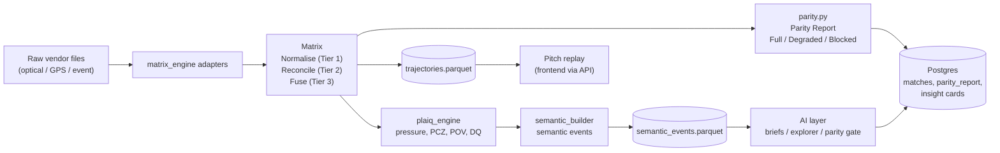
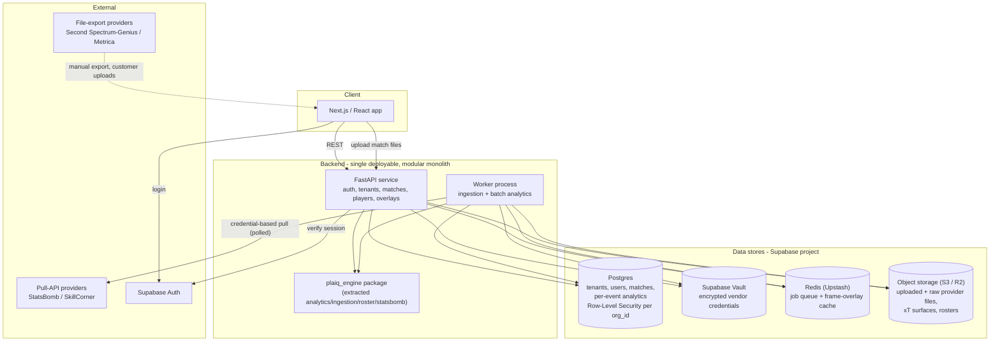

# Ponta Architecture

See [README.md](README.md) for the baseline assumptions this document builds on (B2B SaaS, batch-only v1, small initial scale, React frontend, solo/bootstrapped).

> **Revised for the AI-native one-product strategy.** The section [Canonical store and AI layer](#canonical-store-and-ai-layer) and [Monorepo and repo strategy](#monorepo-and-repo-strategy) below **supersede** the earlier design wherever they conflict — specifically: per-event analytics rows in Postgres (now Parquet + DuckDB), the Plaiq-only engine extraction (now `matrix_engine` + `plaiq_engine`), and the build order at the end. The remaining sections (connectors, credential and identity custody, auth, deployment, per-tenant modules, platform-licensed data) still apply and are updated in place where noted. References to "PLAIQ" in older text mean the decision-quality engine, now `plaiq_engine`. **Terminology warning:** older sections use "Tier 1 / Tier 2" for *compute* (Tier 1 = match-level batch analytics at ingestion; Tier 2 = on-demand per-frame overlays). That is unrelated to the **data tiers** in [data-tiers.md](data-tiers.md) (single source / unpaired / paired). In this document, compute is now called the **batch tier** and the **on-demand tier**, and "Tier 1/2/3" always means data tiers.

## Guiding principle

The prototype already contains a real asset worth protecting: a well-tested, well-specified analytics core (`analytics/`, `ingestion/`, `roster/`, `statsbomb/`, `pitch_config.py` in `PONTA-PROTOTYPE/` — 964 passing tests (about 382 behavioural), a 1,100-line living spec in `ANALYTICS_SPECIFICATION.md`). The architecture's job is to **cut a clean seam between that engine and the Streamlit UI**, then build a proper product around the engine — not to rewrite the math, and not to over-engineer infra for a scale you don't have yet.

Everything below is chosen to minimize ops burden for a solo builder: managed services over self-hosted, a modular monolith over microservices, and synchronous simplicity wherever the batch-only requirement allows it.

## Canonical store and AI layer

Every uploaded file — one SkillCorner feed, or paired STATSports + optical exports — is compiled into one canonical, quality-scored store that both the replay UI and the AI agents read. See [data-tiers.md](data-tiers.md) for what each data tier unlocks and [ai-layer.md](ai-layer.md) for how the AI uses the store.



### Storage: hybrid, by access pattern

**Postgres (Supabase)** holds what is relational and tenant-scoped: organisations and users, roster/`identity_registry`, match metadata, and generated **insight cards**. A match record carries `fusion_tier` (`tier_1_single` / `tier_2_reconciled` / `tier_3_fused`), the `parity_report` (JSONB), the URIs of its two Parquet artifacts, `engine_version`, `schema_version` and the existing `ownership_model` tag. Row-Level Security on `org_id` applies as before. Tracking and per-event analytics rows are **no longer** stored as Postgres rows.

**Object storage (Cloudflare R2 / S3 / Supabase Storage)** holds, per match under a tenant-prefixed path:

- `trajectories.parquet` — the unified tracking schema (timestamp, period, `person_id`/player ref, team, x/y in metres, velocity, speed, acceleration, `source_attribution`, per-frame `confidence_score`). **Physiological columns (heart rate, load/power metrics) exist only when the match has a source for them**; there are no zero-filled placeholders. Read by the frontend replay path only.
- `semantic_events.parquet` — the output of `plaiq_engine/semantic_builder.py`, one enriched row per pass/carry/off-ball run/defensive action, precomputed at ingestion. Read by the AI layer and by analytics endpoints. Schema in [ai-layer.md](ai-layer.md#the-semantic-football-event).

**DuckDB** is the query engine over those files (embedded in the API process, reading from object storage). It is dramatically cheaper and faster than stuffing tens of millions of tracking rows into Postgres, and it is what the typed `query_semantic_events` tool runs on.

**Tenant isolation is no longer provided by RLS for this data — and that must be designed for explicitly.** Row-Level Security protects Postgres rows; it does nothing for Parquet files in a bucket. The API is therefore the only reader: it resolves the caller's `org_id`, constructs the object path itself under that org's prefix (never accepting a path or URI from the client or from the model), and issues short-lived access to that prefix only. The AI tools receive a `match_id` that the API has already authorised. Cross-tenant queries are structurally impossible because no query is ever built over more than one org's prefix. Test this the way RLS is tested: with an automated cross-tenant-access test in CI.

**On-demand per-frame overlays (pitch-control, value surface) — the old "compute Tier 2" — are still computed on demand** by `plaiq_engine` and cached in Redis as before — those depend on frame, possession and the live heatmap view, which cannot all be precomputed. What moves to Parquet is the *event-level* analytics (POV, decision quality, movement value, ΔV) and the trajectories themselves, which the earlier design wrote to Postgres.

### Services

- **API (FastAPI)** — modular monolith, as before, with the AI layer as a **module inside it**, not a separate service (small scale; one deployable). Adds SSE streaming for AI responses. Enforces the hard rules in [ai-layer.md](ai-layer.md#hard-rules-non-negotiable): typed tools only, citation verification, pseudonymised prompts.
- **Worker** — runs the ingestion pipeline off a named queue (the earlier queue-naming and idempotency-key decisions in §4 still apply). Queue technology stays RQ unless a concrete need for Celery/Dramatiq's richer scheduling appears; this is a build-time choice, not an architectural one.
- **Ingestion pipeline order** (replaces the §4 step list): upload/pull → provider adapter → Matrix (Normalise always; Reconcile/Fuse only when the data tier qualifies) → `parity.py` → data-quality gate and preview → `plaiq_engine` → `semantic_builder` → write both Parquet artifacts → write Postgres match row and Parity Report → enqueue brief generation → mark `ready`.

### Plaiq's input: through Matrix, with an equivalence test

The new flow routes tracking data through Matrix's normalised schema before `plaiq_engine` consumes it (the earlier "Plaiq runs on Matrix output *or* on its own" optionality is retired for the app). This is a real change to the numbers' provenance, not just plumbing: Matrix's coordinate normalisation, direction handling and velocity/acceleration derivation could change Plaiq's outputs relative to the prototype's direct-ingest path. **The extraction must include an equivalence test** — Plaiq results on the sample matches, fed through Matrix's schema, must match the prototype's golden outputs within a stated tolerance, and any difference must be explained and recorded as an `engine_version` change ([engine-governance.md](engine-governance.md)). Event-only StatsBomb analysis does not pass through tracking normalisation and keeps its own path.

## Monorepo and repo strategy

Production work moves to a **new `ponta-platform` monorepo**. `PONTA-PROTOTYPE` is tagged at its last commit and retained, frozen, as the validation record (the Streamlit app, the demo scripts and the numbers in `matrix_engine/README.md` remain reproducible there).

```
ponta-platform/
├── packages/
│   ├── matrix_engine/        # adapters, sync, identity, fusion, confidence, quality, export
│   │   ├── adapters/         # Metrica, SkillCorner, STATSports (+ later Catapult, Second Spectrum, …)
│   │   ├── pipeline.py       # MatrixPipeline.run() -> UnifiedTrackingDataset
│   │   └── parity.py         # AnalyticsParityReport (Full/Degraded/Blocked)
│   └── plaiq_engine/         # hex grid, PCZ, xT, POV, DQ, failed-pass inference, event-only mode
│       ├── match_analysis.py # MatchAnalysis façade (replaces Streamlit state)
│       └── semantic_builder.py
├── apps/
│   ├── api/                  # FastAPI REST + SSE, AI layer module
│   ├── worker/               # ingestion + batch analytics + brief generation
│   └── web/                  # Next.js (TypeScript): Brief, Pitch Replay, Ask Ponta
└── docs/ARCHITECTURE.md      # points back to this blueprint
```

Rules carried into the new repo:

- **No Streamlit imports anywhere in `packages/`.** `app.py` is not ported; its pitch-rendering logic (`make_plotly_frame`, `app.py:1372-1873`) is the reference for the web pitch canvas.
- **Dependency direction:** `matrix_engine` never depends on `plaiq_engine`; `plaiq_engine` may consume `matrix_engine`'s unified dataset. Shared parsing currently in `ingestion/`, `roster/`, `statsbomb/` and `pitch_config.py` moves to where it belongs (adapters and `pitch_config.py` under `matrix_engine`; event-only/StatsBomb analytics and `roster/` under `plaiq_engine`) — keep the one-directional rule. *(Revised after the import-graph check: `roster/` belongs in `plaiq_engine`, not `matrix_engine`, because Matrix never imports it. See [status.md](status.md) and [platform-extraction-task.md](platform-extraction-task.md).)*
- **Tests travel with the code and grow.** The prototype's 964 passing tests carry over unchanged to prove the extraction is behaviour-preserving (note ~582 are one parametrised ring-distance test; the behavioural core is ~382, so do not treat "964 green" as a stronger guarantee than it is). New tests are required for the semantic builder, the Parity Report, the equivalence test above, cross-tenant isolation, and the AI golden set ([engine-governance.md](engine-governance.md#ai-governance)).
- **Preserve git history** for extracted modules where practical (e.g. `git filter-repo`/subtree split) so spec changelog discipline and blame stay intact. Not a blocker if costly.

Execution spec: [platform-extraction-task.md](platform-extraction-task.md).

## Evidence from the current code that shapes this design

The prototype already has a two-tier compute pattern baked in via Streamlit's cache decorators (`app.py`):

- **Tier 1 — match-level batch analytics**, computed once and reused: `load_analytics_with_value`, `load_movement_value_scores`, `load_pov_scores` (`app.py:274-338`, all `@st.cache_data(show_spinner="Computing ... (first load only)…")`). This is POV, Movement Value, and Decision Quality for every event in the match.
- **Tier 2 — on-demand, per-frame overlays**, LRU-cached: `compute_value_cached`, `compute_control_cached` (`app.py:890-1025`, `@st.cache_data(..., max_entries=200-500)`), keyed by `(game_id, frame, possession)`. This is the pitch-control / value-surface heatmap you scrub through interactively.

This split maps directly onto a production architecture: Tier 1 becomes a **background job that runs once at match ingestion** and writes to a real database; Tier 2 becomes a **cheap on-demand API endpoint backed by a shared cache** (Redis instead of per-Streamlit-session memory).

## Product context: bring-your-own-data

PLAIQ doesn't own the tracking/event data — clubs already hold that relationship (and spend) with a vendor. Our job is to plug into whatever data they already have. Vendor access models differ enough that this shapes the ingestion architecture directly:

- **StatsBomb, SkillCorner** — real, self-serve, credential-based pull APIs (username/password per paying customer).
- **Metrica Sports** — an API exists but is a gated "Elite" feature oriented around video workflows, not a casual self-serve toggle; most customers export EPTS-format files from Metrica Cloud instead.
- **Second Spectrum (Genius Sports)** — no public/self-serve API at all. Access is enterprise, sales-led, delivered through their own "Performance Studio" product. The only path in without a formal partnership is the customer exporting and uploading their own match files.

Consequence: **file upload is not a lesser fallback tier — it's mandatory, first-class infrastructure**, since it's the only path for a meaningful share of the target market (including some of the most valuable customers, e.g. clubs on Second Spectrum). See [Data ingestion connectors](#3-data-ingestion-connectors) below.

## High-level architecture



## Component breakdown

### 1. `plaiq_engine` (and `matrix_engine`) — the extracted engine packages

*(Revised: two packages are extracted, not one — `matrix_engine` for ingestion, normalisation, reconciliation, fusion and the Parity Report, and `plaiq_engine` for the spatial/decision math plus `semantic_builder`. See [Monorepo and repo strategy](#monorepo-and-repo-strategy). The `MatchAnalysis` façade below remains the design for `plaiq_engine`.)*

Promote today's `analytics/`, `ingestion/`, `roster/`, `statsbomb/`, and `pitch_config.py` into a standalone, pip-installable, **UI-agnostic** package (no Streamlit imports anywhere — currently true already, which is why this extraction is low-risk). Add one clean public entry point on top of the existing internals, e.g.:

```python
class MatchAnalysis:
    def __init__(self, tracking_home, tracking_away, events, roster, pitch_config): ...
    def pressure(self, frame) -> ...
    def control(self, frame) -> ...
    def value_surface(self, frame, possession) -> ...
    def event_pov(self) -> pd.DataFrame        # Tier 1
    def event_decision_quality(self) -> pd.DataFrame  # Tier 1
    def player_timeline(self, player_id) -> ...
```

This formalizes what `app.py` currently does ad hoc via 58 imported names (inventoried in `ponta-platform/docs/MATCH_ANALYSIS_INVENTORY.md`; about half are core analysis, the rest rendering and roster helpers), and is the single highest-leverage step: it's the prerequisite for the API, the worker, *and* any future licensing/API-product angle, without touching the underlying formulas. The carried-over prototype tests keep protecting correctness through the move.

### 2. API service (FastAPI, modular monolith — not microservices)

One deployable service exposing REST endpoints, organized by domain module (auth/tenants, matches, ingestion status, players, overlays) but running as a single process at this scale. Responsibilities:

- AuthN/Z: verify sessions from the managed auth provider, resolve `org_id`, enforce tenant scoping on every query.
- Serve Tier-1 results straight from Postgres (fast, no engine invocation needed at request time).
- Serve Tier-2 frame overlays by calling `plaiq_engine` directly and caching the result in Redis (mirrors today's `max_entries=200-500` LRU pattern, but shared across users/processes instead of per-Streamlit-session).
- Kick off ingestion jobs (enqueue to the worker) and expose job status for the "processing…" UI state.

Why a monolith, not microservices: at "small scale, solo builder," service-per-concern buys you nothing but deploy/ops overhead. Splitting the worker out is the *one* justified separation, because it has different scaling characteristics (CPU-bound batch jobs vs. low-latency request/response).

### 3. Data ingestion connectors

Three connector types, side by side, because vendor access genuinely differs — not one uniform abstraction:

1. **File upload** (mandatory for every provider; the *only* path for Second Spectrum/Genius customers, and the likely-default path for Metrica). A drag-and-drop UI accepting each vendor's native export, mapped through the existing `ingestion/` adapters (`epts_io.py`, `second_spectrum_io.py`, `genius_events_io.py`, `metrica_io.py`, and — per the note below — `skillcorner_io.py`). No credentials involved; the uploaded file itself is the input to the same `process_match` worker job used by pull connectors.
2. **Credential-based pull connectors** (StatsBomb today; SkillCorner's live "connect your account" pull is deferred, see below). The customer enters their vendor username/password once via a "Connect" flow in Settings; we store it via the credential vault (below) and a scheduled job polls for new matches — **neither vendor offers webhooks**, so sync is necessarily poll-based (a nightly job plus a manual "Sync now" button in the UI), not push-based.
3. **Watched cloud-storage/SFTP drop** (future placeholder, not v1). Bespoke enterprise data delivery — the way Genius Sports actually tends to operate for large accounts — often lands in a customer-provisioned bucket or SFTP endpoint rather than a public API. Worth a placeholder in the schema (a `connector_type` enum with room for this) even though it's not built until a specific deal calls for it.

**Licensing-scope awareness.** StatsBomb (and presumably others) license data at the league/season level — our pull connectors must only ever surface what the *customer's own credentials* expose, and never cache or share data across tenants even where two customers' vendor accounts happen to overlap. We're an enhancement layer on data the customer has already licensed, not a redistribution channel.

**Why SkillCorner splits across both connector types, not just one.** `ingestion/skillcorner_io.py` already fully parses SkillCorner's tracking/event format — that parsing logic isn't new work, so there's no reason to gate it behind the harder "live pull" connector. The prototype's existing SkillCorner support was built against their *public open-data* snapshot (a fixed set of sample matches, not a live customer account), so what's genuinely unbuilt is a real, authenticated "connect your SkillCorner account and auto-sync" integration — that's the part deferred to Phase 4 (`roadmap.md`). File-upload support, by contrast, is cheap to add now: it's the same adapter, just fed a manually-exported file instead of a live API response. **One assumption worth verifying early with a design partner**, since it hasn't been confirmed against a real paying account: that a SkillCorner customer's own match export uses the same schema as the public open-data format the adapter was built against — if the paid product's export differs in structure, the adapter may need adjustment before this is genuinely a zero-new-work item.

This split has a real go-to-market reason behind it, not just an engineering convenience one: clubs already on SkillCorner's (comparatively cheaper) tracking hardware are a plausible early-adopter segment specifically *because* they tend to be smaller clubs without StatsBomb/SkillCorner Game-Intelligence-scale analytics budgets or in-house data teams — see [go-to-market.md](go-to-market.md#who-to-target-first-not-who-youll-eventually-serve). Getting SkillCorner-sourced matches usable at all (via upload) as early as possible directly serves that segment, even before the more polished live-sync experience exists.

### 4. Worker (background jobs)

*(Revised: the step list below is superseded by the ingestion pipeline order in [Canonical store and AI layer](#canonical-store-and-ai-layer) — Matrix and the Parity Report now run before Plaiq, and outputs go to Parquet plus a slim Postgres row rather than per-event Postgres rows. The queue-naming and idempotency-key guidance in this section still applies unchanged.)*

A single worker process consuming a Redis-backed queue (RQ is simplest to operate solo; Celery if you anticipate needing its richer scheduling later). One job type to start: `process_match(tenant_id, connector_type, provider, match_ref)`:

1. Pull/parse raw data via the connector (file upload already sitting in object storage, or a credential-based pull using the existing provider adapters in `ingestion/`).
2. Run roster/identity resolution (`roster/build_roster.py`, `statsbomb/identity.py`).
3. Run `plaiq_engine` Tier-1 analytics (POV, Decision Quality, Movement Value, ΔV) for every event.
4. Persist: per-event analytics rows → Postgres; heavy per-match artifacts (xT surfaces, hex grid, roster JSON, raw provider files) → object storage.
5. Mark match `ready`; surface failures with enough detail to debug (this pipeline has a lot of moving parts — corrupt/partial provider data should fail loudly, not silently degrade).

**Two cheap-now decisions that avoid a real retrofit once job volume/diversity grows**, neither of which adds operational burden today:

- **Name the queue by job type from the start** (`ingestion`, with the RQ/Celery queue name explicit in config) even though `process_match` is the only job in it for now. When a second job type shows up later (e.g., Team Context ML training jobs, report generation), it gets its own named queue and worker pool instead of sharing one undifferentiated queue — cheap to name correctly on day one, a real customer-facing delay (a slow job head-of-line-blocking match ingestion for every tenant) if left undifferentiated until it's actually a problem.
- **Give every job an explicit idempotency key** (e.g., `(tenant_id, provider, match_ref)`, checked before the job does any writes) rather than relying on "jobs happen to be idempotent" as an implicit property. `operations.md`'s resilience section already calls for retryable jobs — this is the concrete mechanism that makes retries and multiple concurrent workers actually safe, not just assumed safe, once ingestion volume justifies running more than one worker process.

### 5. Data stores — Supabase

*(Revised: Postgres no longer holds per-event analytics or tracking rows — those are Parquet in object storage queried by DuckDB; see [Canonical store and AI layer](#canonical-store-and-ai-layer). Everything below about Supabase as the tenancy/auth/Vault platform, RLS on `org_id`, and pooled connections still applies. The Redis and object-storage notes still apply, with object storage now also holding the canonical Parquet artifacts.)*

**Postgres, on Supabase**, chosen over Neon/RDS/Cloud SQL for three reasons specific to this product: Row-Level Security is a first-class Supabase feature (not bolted on), which is exactly the `org_id`-scoped multi-tenancy model this architecture already calls for; it ships **Supabase Vault** for exactly the credential-custody problem introduced by BYOD pull connectors (see below); and bundling DB + Auth with one vendor (Supabase Auth, see §7) means less integration surface for a solo builder than stitching together separate providers. SOC 2 Type II certified, encryption at rest and in transit by default. Schema: tenants, users, match metadata, per-event analytics tables, all with `org_id` and an RLS policy — DB-per-tenant is unnecessary complexity at this scale and can be revisited if a customer contractually demands hard isolation. (Neon remains a reasonable alternative if cost/branching matters more than the built-in vault — see the trade-off in §6.)

**Connect via Supabase's pooled connection string (PgBouncer) from the first migration, not a direct connection.** Costs nothing to configure correctly on day one; retrofitting it later means finding and migrating every service's connection string under production load, right around the point multiple worker/API instances actually need it — a classic "worked fine in dev, fell over once scaled out" failure mode worth designing away for free now.

- **Redis** (Upstash): job queue broker + Tier-2 overlay cache — **as two logically separate stores** (either separate Upstash instances, or separate logical DB indices on one instance), not one shared client/keyspace. A durable FIFO job queue and an evictable LRU cache have different eviction/memory-pressure characteristics; separating them costs nothing while volumes are low and avoids one growing workload's eviction pressure silently degrading the other once either grows.
- **Object storage** (Cloudflare R2 for cheaper egress, or S3): uploaded match files, raw provider files pulled via connectors, and precomputed heavy artifacts that don't belong in relational rows.

### 6. Credential & identity custody

BYOD pull connectors mean we're storing customers' third-party vendor logins — a new, real security requirement that a "we generate our own data" model wouldn't have had. "Encryption at rest" alone (which every managed Postgres provider offers) protects against a stolen disk, not against a leaked backup or an overprivileged DB role reading a plaintext column. The actual mitigation is application-level envelope encryption:

- Vendor credentials are stored via **Supabase Vault** (`vault.create_secret()`), never as a plain column in an ordinary table — plaintext never lands anywhere queryable by default.
- Only the **worker** role has `decrypted_secrets` access; the API service and any reporting/analytics DB role never see plaintext, even by accident.
- Decrypted values are never logged, including in error traces.
- Disconnect/reconnect (revoke-and-replace a credential) is a first-class, easy action in the product — assume rotation will happen.

This is a v1 requirement, not a later hardening pass, because it's introduced the moment the first credential-based connector ships. Separately: once selling into clubs, larger customers' procurement/security teams will likely run a vendor questionnaire (SOC 2 report, DPA, GDPR posture) — a compliance-readiness item to track alongside the deferred business-model topics in [README.md](README.md), triggered by an actual enterprise deal rather than needed on day one.

**Player identity pseudonymization follows the same envelope-encryption shape as vendor credentials above, applied to a different asset.** Analytics tables, per-event rows, ML training data, caches, and logs should reference an opaque `person_id`, never a name column directly. A single `identity_registry` table (name, DOB, nationality → `person_id`) holds the only column-encrypted plaintext, decrypted by a narrow API-edge call for an authorized viewer of that org's own data — never cached or logged beyond the request. This is a stronger GDPR posture, not just a security one: pseudonymization is explicitly named in GDPR Art. 4(5)/32 as a recommended safeguard, which directly strengthens the named-athlete risk `legal-compliance.md` already flags for Decision Quality ratings.

One real constraint this interacts with: Matrix's cross-vendor identity matching (`matrix_engine/identity.py`; the prototype's `roster/build_roster.py` is now planned for `plaiq_engine`, see the module split above) needs fuzzy string matching on plaintext names to reconcile e.g. "R. Lewandowski" against "Robert Lewandowski" across vendor exports — ciphertext can't be fuzzy-matched, and restricting matching to vendor-supplied numeric IDs would gut the entire reconciliation premise Matrix is built on (vendors don't share a common player ID in the first place). The resolution: a transient plaintext window scoped to the ingest job only — the worker already has to read the raw vendor file's bytes regardless — followed by immediate tokenization. Identity is resolved once at ingestion; every downstream system only ever sees `person_id`.

Unlike the credential vault, this doesn't need to be fully built before v1 ships — there's no real personal data flowing through the prototype today. What's cheap to lock in now versus what should wait for an actual trigger:

| Piece | Cost now | Build trigger |
|---|---|---|
| Schema shape — `person_id` foreign keys everywhere instead of inline name columns | Free — same schema-design effort either way | Now, at the first real schema migration |
| Vault-backed `identity_registry` + decrypt-only-at-API-edge code path | Real engineering work | First real customer data in the pipeline (same trigger as the credential vault above) |
| Per-tenant KMS keys (vs. one shared app key) | Moderate engineering work | First enterprise-scale deal / security questionnaire |
| Customer-managed keys (BYOK) | Significant engineering + UX work | A specific deal that demands it, not built speculatively |

The schema-shape row is the only one that's cheap-now/expensive-later — the same "tag it now, avoid a re-architecture later" logic already applied to the `ownership_model` field in [Future evolution: platform-licensed data](#future-evolution-platform-licensed-data) below.

### 7. Auth

**Supabase Auth** — paired with the Postgres choice above so `auth.uid()` is usable directly inside RLS policies, and organizations/multi-tenant user management, invites, and session handling come out of the box rather than being built from scratch.

### 8. Frontend (Ponta Frontend)

*(Revised: the three core views are now Match AI Brief, Pitch Replay and Ask Ponta, plus a Parity onboarding gate — see [frontend.md](frontend.md). Replay frames come from `trajectories.parquet` via the API. The Plotly-first approach below remains the fast path; the feedback's HTML5 Canvas scrubber is the target if Plotly's frame-scrubbing performance on 25 Hz data is inadequate — decide with a spike in the frontend phase, not in advance.)*

Next.js + React, calling the FastAPI backend over REST (plus SSE for AI responses). *(Frontend framework is an open decision: this document was written as Next.js, the UI prototype is Vite and React Router, and the leaning is a Vite static export. Treat "Next.js" below as "the web app" until decided; see [status.md](status.md#open-decisions).)* To move fast, port the existing Plotly figures via `react-plotly.js` initially (the pitch-rendering logic in `app.py:1078-1873` — pitch shapes, hex overlays, player markers, event ghosts — translates fairly directly to Plotly.js figure specs passed over the API) rather than reinventing the visualization layer from scratch on day one. A custom canvas/deck.gl renderer is a reasonable v2 if Plotly's performance or interactivity ceiling becomes a real constraint. See [frontend.md](frontend.md) — **Ponta Frontend**, the authenticated client portal both Matrix's and Plaiq's tools live in — for the full UI/UX layout. Not to be confused with [website.md](website.md) — **Ponta Website**, the separate, unauthenticated commercial site — which is deliberately not part of this stack at all (see below).

### 9. Deployment

Fly.io or Render for the API + worker + web (containers, minimal ops, cheap at low scale), Supabase (Postgres + Auth + Vault) plus Upstash Redis and R2/S3 object storage as above. Add Sentry for error tracking early — this pipeline has enough moving parts (provider quirks, identity resolution edge cases) that silent failures in production will be costly to debug blind.

**Domain structure**: `pontahq.com` (root domain) is **Ponta Website** (`website.md`) — built but not yet public; to be launched with the product — a separate static site served as a Cloudflare Worker with assets from `dist/`, explicitly not part of this deployment or stack. `app.pontahq.com` is reserved for **Ponta Frontend** (§8), the Next.js app calling the FastAPI service; **that product is not live yet**, and the website's Sign in control is disabled until it is. Worth reserving `api.pontahq.com` for the FastAPI service itself now, even while the frontend is its only caller — cheap to decide once, and avoids a URL/CORS change later if the API is ever exposed as its own product surface (§1's note that the `plaiq_engine` extraction is "the prerequisite for... any future licensing/API-product angle").

### 10. Per-tenant custom modules (supporting the design-partner/custom-tools track)

`go-to-market.md`'s design-partner motion includes building bespoke tools/dashboard views for a small number of early customers, with the explicit intent of generalizing what's learned into the core product. That only works cleanly if bespoke work is built *within* this architecture as a configurable extension, not as a one-off fork of it — a forked codebase can't graduate into the shared product without a rewrite, which defeats the entire point of doing custom work in the first place.

The concrete mechanism this calls for, and it's a modest addition to what's already planned, not a rethink:

- **A per-tenant module/feature-flag table** (`org_id`, `module_key`, `config` — a simple addition to the Postgres schema in §5) that gates which optional views/widgets a given organization sees, alongside the standard RLS-scoped data access. Today's design only varies *data* per tenant (via RLS); this adds the ability to vary *which features* a tenant sees, without needing separate deployments or codebases per customer.
- **A bespoke tool starts as a module built once, flagged on for one `org_id`.** If it proves broadly useful, the fix to "ship it to everyone" is flipping the flag's default and building any remaining generalization work (e.g., removing hardcoded assumptions specific to that first club) — not re-implementing it.
- **This doesn't change the modular-monolith or Tier-1/Tier-2 compute story** — a custom module still calls `plaiq_engine` and the same API/worker split as everything else; it's a thin routing/visibility layer on top, not a parallel system.

This is worth building as soon as the first custom-tool engagement is actually happening (realistically alongside `roadmap.md`'s Phase 3), not speculatively before there's a concrete bespoke request to build against.

## Future evolution: platform-licensed data

Everything in [Data ingestion connectors](#3-data-ingestion-connectors) assumes bring-your-own-data: the customer owns the vendor relationship, we only add the analysis layer. That's deliberately how v1 works — it means zero data-licensing cost or negotiation on the critical path to shipping. But it also means the product only reaches customers who already pay StatsBomb, SkillCorner, Metrica, or Second Spectrum — a real ceiling on addressable market (see [features.md](features.md)'s "Future evolution" section for the product/business framing).

The longer-term option is for PLAIQ itself to license data directly from a provider at the platform level, so a customer can pick a competition and start analyzing with no vendor relationship of their own — a **"PLAIQ Data included"** tier sitting alongside BYOD, not replacing it. That's a business-development effort (negotiating a commercial license), not something this architecture unlocks by itself, and it isn't v1 scope.

**What's worth doing now, cheaply, to not block it later:** tag every match record with its **ownership model** — `customer_connector` (BYOD: uploaded or pulled under one tenant's own credentials, private to that `org_id`) vs. `platform_licensed` (ingested once by PLAIQ under its own license, read-accessible to every subscribing tenant). This one field is the difference between "add a tier later" and "re-architect the multi-tenancy model later," because platform-licensed matches genuinely break the "every row is privately scoped to one `org_id`" assumption the RLS design otherwise relies on cleanly:

- Ingestion stays identical either way — same `process_match` job, same `plaiq_engine` analytics, same Postgres/object-storage writes. Only the credential source and the resulting row's ownership tag differ.
- RLS policy needs a second branch alongside the standard `org_id = current_org()` check: `ownership_model = 'platform_licensed' AND current_org() has an active subscription entitling access` (exact entitlement logic — e.g. any paid plan, or a specific data add-on — is a pricing decision for later, not an architecture one).
- Licensing cost becomes a COGS line that a future pricing model needs to account for on the platform-licensed tier specifically; BYOD tiers are unaffected and stay pure software margin.

## Suggested build order

**Revised build order (supersedes the original list below, which is kept as history):**

1. **Stand up `ponta-platform` and extract both engines** (`matrix_engine`, `plaiq_engine`), carrying all prototype tests; add `MatchAnalysis`, `MatrixPipeline`, and the Plaiq-via-Matrix **equivalence test**. ([platform-extraction-task.md](platform-extraction-task.md))
2. **Add `parity.py` and `semantic_builder.py`**, with their own tests. This is the AI bridge and the honesty mechanism; nothing in the AI layer can start without it.
3. **Supabase (Postgres + RLS + Auth) + FastAPI skeleton + object storage**, including the cross-tenant access test for Parquet paths.
4. **Universal file-upload connector → worker pipeline → both Parquet artifacts + match row.** Tier 1 end-to-end for optical (SkillCorner, Metrica) and event-only (StatsBomb) data; STATSports GPS as a physical-only Tier 1 source.
5. **AI workflows over the semantic store**: post-match brief, typed-tool natural-language explorer, parity gate — with the citation verifier and golden question set ([ai-workflows-task.md](ai-workflows-task.md)).
6. **Next.js web app**: Match AI Brief, Pitch Replay, Ask Ponta, Parity onboarding gate ([frontend.md](frontend.md)).
7. **Deploy**, wire Sentry and LLM cost/audit logging, confirm backups restore.
8. **StatsBomb pull connector** with Vault credentials; later SkillCorner live pull.
9. **In parallel from step 1, not after step 8:** design-partner outreach and real-data validation for Tier 2 (overlap window) and Tier 3 (paired match). Tier 2/3 engineering (physiological ingestion, baselines, reconcile/fuse productisation) starts when real data exists, not before.

**Original build order (pre-pivot, retained as history):**

1. Extract `plaiq_engine` as an installable package with the `MatchAnalysis` façade; keep all existing tests green.
2. Stand up the Supabase project (Postgres schema with RLS + Auth) + FastAPI skeleton.
3. Build the **universal file-upload connector** first — it's provider-agnostic, it's the only guaranteed path for every vendor (mandatory for Second Spectrum customers), and it reuses `ingestion/` adapters that already exist almost as-is, **including `skillcorner_io.py`** (see the note above on why SkillCorner-via-upload is cheap enough to include here rather than wait for Phase 4). This gets a full, real ingestion-to-analytics pipeline working fastest, and opens the door to SkillCorner-sourced customers — a deliberately prioritized early segment, see `go-to-market.md` — from day one.
4. Add the **StatsBomb credential-based pull connector** as the first "connect your account" experience — cleanest, most self-serve API of the four vendors — including the Vault-backed credential storage from §6.
5. Build Tier-2 overlay endpoints + Redis caching.
6. Build the Next.js frontend against the API, starting with the Player Performance view (your most differentiated screen) before Event Explorer.
7. Deploy the full stack; wire up Sentry.
8. Add the **SkillCorner live pull/API connector** (the "connect your account, auto-sync" experience — distinct from the file-upload support already live since step 3), then treat Metrica's API and any Second Spectrum/Genius partnership as later, business-development-gated work rather than v1 engineering.
