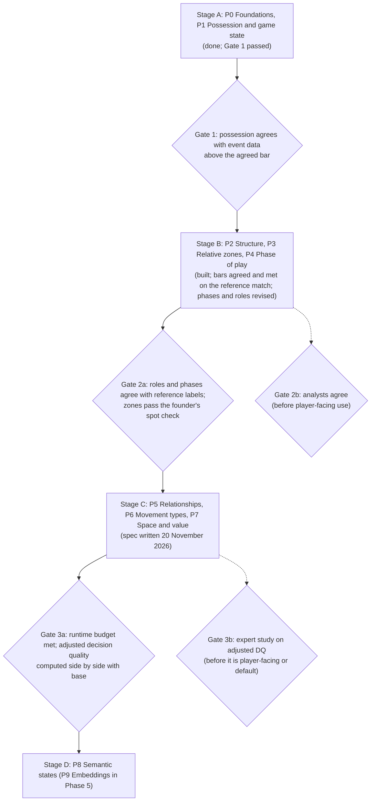

# Ponta Context Packages

> **Status: adopted 17 November 2026; Stage A built and Gate 1 passed the same day; Stage B built the same day; its Gate 2a bars and thresholds agreed by the founder; met on the reference match (zones 47 of 50 on the founder's spot check); phases and roles revised on 18 November 2026 (P4 and P2 0.2.0); restarts found from positions without a feed (P4 0.3.0, 18 November 2026); across SkillCorner's 20 open-data matches Gate 2a is met for formations and pooled phases, and short on five matches.** Stage A (P0, P1) is done; Stage B (P2, P3, P4) is built ([context-structure-task.md](context-structure-task.md)). **Revised 17 November 2026 (decision 4a): Stages B to D proceed now** without waiting for analysts, validated against references (Gate 2a, Gate 3a); analyst agreement (Gate 2b, Gate 3b) is still required before anything is player-facing or called validated. P9 belongs to Phase 5. Source: the founder's work plan "Ponta Context Packages: Work Plan" (17 November 2026), adjusted after review. The four founder decisions are recorded below.

See [README.md](README.md) for the document index, [ai-layer.md](ai-layer.md) for how the AI reads what these packages produce, [data-tiers.md](data-tiers.md#context-packages-by-data-type) for what each kind of data can support, and [roadmap.md](roadmap.md) for where the work sits.

## Why this exists

The AI layer can only explain what its context describes, and today that context stops at single actions: one row per pass, carry, run or defensive action, with its score, the pressure on the player and a pitch zone ([ai-layer.md](ai-layer.md#the-semantic-football-event)). That cannot answer the questions coaches actually ask: how a team built up against a high press, when its shape broke, why the opponent's counters hurt. An AI built over single actions would summarise events, and it would sound generic quickly.

Context packages add the missing layers: **possession, game state, team structure, relative zones, phase of play, relationships, movement types, space and value, and match episodes**, each computed deterministically at ingestion, each defined, versioned and covered by the Data check.

## Strategy change (decided 17 November 2026)

**From** "an explainable decision-quality engine with a grounded AI brief", where Decision Quality is the headline and overlaps heavily with SkillCorner Game Intelligence ([competitive-landscape.md](competitive-landscape.md#skillcorner-game-intelligence)).

**To** "a **match context model** that the AI explains": Ponta compiles any supported provider's data into one versioned, Data-checked description of the whole match (possession, phase, shape, relationships, space), and every AI answer cites the moments or episodes behind it. Decision Quality becomes one field among many.

What changes:

- **Differentiation** moves from one metric to the breadth and honesty of the context, and its consistency across providers.
- **The AI build waits for the context.** [ai-workflows-task.md](ai-workflows-task.md) starts after Stage A at the earliest, preferably after Stage B.
- **Wedge A's pitch** becomes "ask anything about your match, every answer cited to an episode" ([go-to-market.md](go-to-market.md#two-wedges-one-to-lead-with-added-15-november-2026)).
- **Discovery calls (E1)** add: which context questions can you not answer today, and do you rebuild provider metrics yourselves?

What does not change: bring your own data, post-match batch only, Tier 1 first, the Data check, the evidence gates E1 to E3, and every claim rule in [ai-layer.md](ai-layer.md#hard-rules-non-negotiable).

### Founder decisions

1. **Repositioning agreed.** The AI build waits for Stage A at the earliest, preferably Stage B.
2. **Ponta computes its own context.** Where a club already has provider-derived metrics (for example a provider's phases of play or run categories), they are stored against Ponta's vocabulary with their source, for comparison and validation, never as Ponta's source.
3. **Unvalidated fields may reach analysts**, labelled "estimated, not yet validated". They never reach a player-facing view until their validation step has passed.
4. **Commit to Stage A only.** Stages B to D are planned and unscheduled; P9 is Phase 5. *(Superseded by 4a the same day.)*
4a. **Proceed through Stages B to D without waiting for analysts** (founder, 17 November 2026). Published research supplies the definitions, taxonomies and starting thresholds; the data already holds reference labels to measure against (SkillCorner's player roles, phases of play and game state; Metrica's logged events); the founder spot-checks on the replay. Gates 2 and 3 are split: the **reference** half (2a, 3a) unlocks the next stage; the **analyst** half (2b, 3b) is required before any context label is player-facing, called validated, or (for adjusted decision quality) made the default. Until then labels reach analysts as "estimated, checked against references, not yet validated by analysts".

## Principles

- **Code computes, the model explains.** Packages are deterministic code run once at ingestion. The model never computes geometry.
- **No coordinates reach the model.** Packages output labelled fields and segments, never raw positions.
- **Every field is defined, versioned and checked:** a written definition, named thresholds, a package version, a Data check state and a coverage figure.
- **Observed or estimated, always labelled.** Every field is tagged as an observed fact (a distance, a count, a direction) or a model estimate (value, control, decision quality, an inferred label).
- **Context can change the objective, transparently.** Game state and phase change what counts as a good action (a safe pass at 3–0 in the 87th minute should not score as a loss), but the base score is always kept, and any adjustment names its weights in the working.
- **Works on any supported provider, honestly.** Packages read Matrix's canonical schema, never one vendor's format; what each kind of data can support is stated per package ([data-tiers.md](data-tiers.md#context-packages-by-data-type)).
- **Measure before setting a threshold.** Thresholds are proposed from measurements on the regression set, then agreed, named and versioned; none is guessed into code.
- **Validated before players see it.** Analysts may see unvalidated fields, labelled as such; player-facing views wait for validation.

## The package contract

A context package is one self-contained module that turns canonical tracking into named context fields. It is done only when all eight items exist.

| Item | What it must contain |
|---|---|
| Definition spec | Plain-language meaning, the formula, every threshold named and versioned (for example `high_line_m = 40`), known limits |
| Inputs | Which canonical fields and which earlier packages it reads |
| Outputs | Field list with units and an observed or estimated tag; written to the context frame table, segment rows, or both |
| Data check entry | Rules for Full, Degraded and Blocked per data type, the reason text, and a coverage line (share of match time or events labelled) |
| Tests | Unit tests, golden outputs on the regression set, and edge cases: ball undetected, half-time, substitutions, red cards |
| AI exposure | Which fields reach `semantic_states` or `semantic_events`, and which filters it adds to the typed query tool |
| Validation plan | How agreement with analysts (or with event data) is checked, and the bar before player-facing use |
| Version stamp | `package_version` on every row it produces |

**Storage.** Frame-level fields go to `context_frames.parquet` on a fixed grid (5 Hz proposed), keyed by `match_id` and `frame_ts`. Segment-level outputs go to `semantic_states.parquet` (built in P8). Both sit beside `trajectories.parquet` and `semantic_events.parquet` under the tenant's prefix and are read through DuckDB, by the API only ([architecture.md](architecture.md#canonical-store-and-ai-layer)).

**Regression set.** Four tracking matches are available locally, not two: Metrica Sample Games 1, 2 and 3 and SkillCorner 1886347. Games 1 and 2 need the known second-half event-flip issue handled first (`to_single_playing_direction`, reported in `ponta-platform/EXTRACTION_REPORT.md`). SkillCorner's open-data repository publishes more matches than the one used so far; count and licence to be checked. Licensed or unlicensed sample data never enters a repository.

## What already exists to build on

- `plaiq_engine/analytics/hex_analytics.py`: `infer_possession` (event-anchored, frame by frame) and `tag_possession`. The baseline P1 is compared against, and its fallback when the ball is undetected.
- `plaiq_engine/statsbomb/stitch.py`: `get_possession_chains` for event-only data.
- `MatchAnalysis.possession` and `MatchAnalysis.pressure(frame)`: pressure for any frame, not only at events.
- `parity.py`: the Data check generator, extended to accept package entries (P0).
- `semantic_builder.py`: once P1 exists, each semantic event also carries its possession chain, phase and game state.

## Build order and gates

Packages within a stage can run in parallel. **Gate 1 can be met alone**, because the Metrica matches include event data. *(Revised 17 November 2026.)* **Gates 2a and 3a can also be met alone**, measured like Gate 1:

- **P2 roles and shape** against SkillCorner's player roles (every player carries one, for example LCB, DM, CF) and the starting line-up.
- **P4 phases** against SkillCorner's phases of play on every event (in possession: build_up, create, finish, direct, quick_break, transition, set_play, chaotic, disruption; out of possession: high, medium and low block and their defending variants), and against Metrica's logged set pieces. Provider labels are comparison only (decision 2): they measure agreement, they never become Ponta's output.
- **Definitions and thresholds** from published research, cited in the package spec.
- **P3 zones** by the founder's spot check on the replay (50 sampled frames).

**Gates 2b and 3b still need one or two analysts** (Track V in [roadmap.md](roadmap.md)); they gate player-facing use and any claim that a label is validated, not the next stage.

## Packages

Thresholds marked "agreed" are set in [Open decisions](#open-decisions). "Layer" refers to the founder's context layers.

### P0 Foundations (Stage A, committed)

**Depends on:** Matrix canonical schema.

- This document is the package contract.
- A resampling step from canonical trajectories to the context grid, keeping the source rate for precise refinement.
- The `context_frames.parquet` schema: `match_id`, `frame_ts`, `period`, `package_version`.
- A package registry: name, version, dependencies, run order.
- The Data check generator extended to accept entries from packages.
- A golden-output harness for packages on the regression set.

**Done when:** an empty test package runs end to end on the regression set and writes a stamped frame file and a Data check entry.

**Execution spec for P0 and P1:** [context-foundations-task.md](context-foundations-task.md). **Built on 17 November 2026** in `ponta-platform` (`plaiq_engine/context/`); measurements in its `CONTEXT_FOUNDATIONS_REPORT.md`. **Gate 1 passed** against the agreed bar (at least 93% agreement with event-based possession on each Metrica match, possession changes within 15%): 93.7%, 95.7% and 93.6%. All P1 thresholds agreed by the founder on 17 November 2026.

### P1 Possession and game state (Stage A, committed; layer 1)

*(20 November 2026, Stage C.)* P1 also carries FIFA's possession states (`p1_state`, in contest from logged events) and a **ball state** (`p1_ball_state`: controlled, in flight within one team's possession, loose, contested; a duel the same team keeps is its control). **The founder agreed the ball state as the AI layer's "who has the ball" field beside possession**, with the loose cap at 5 s. Evidence: `CONTEXT_RELATIONSHIPS_REPORT.md`, sections 1 and 2.

**Depends on:** P0; event data where available.

- Possession states: home, away, contested, dead ball.
- Possession from ball proximity and control when the ball is detected (observed).
- Possession during ball-detection gaps inferred from player movement, tagged inferred; the event-anchored baseline is the fallback and the comparison.
- Possession chains: start, end, how each began and ended.
- Game state on every frame: score, minute, red cards, dead ball, set-piece type.
- An upload step for final score, goal times and red cards when there is no event data.
- Data check: possession Degraded when the inferred share passes the agreed threshold; game state Blocked when unknown.
- **Measure first:** ball-undetected share, inferred-possession share and agreement with event data on every match in the regression set, reported before any threshold is agreed.

**Done when:** every frame carries a possession label and its source (observed or inferred), and possession agrees with event data on Metrica Game 3 above the agreed bar (Gate 1).

### P2 Team structure (Stage B, built; layer 5)

**Depends on:** P1.

- Each team's defensive, midfield and attacking lines, in and out of possession.
- Line heights (metres from own goal), distance between lines, width, depth and compactness (observed).
- Formation per phase, smoothed over time windows (for example 4-4-2 out of possession, 2-3-5 in possession) (estimated).
- A role per player per window, including variants such as an inverted full-back (estimated).
- Shape changes against the previous window.
- Data check: Degraded when players observed fall below the agreed threshold.

**Done when:** role and shape labels agree with SkillCorner's player roles above the agreed bar, and formation labels are stable and plausible on the founder's spot check (Gate 2a). Analyst agreement on sampled segments (Gate 2b) before player-facing use.

**Built on 17 November 2026** (`plaiq_engine/context/structure.py`; spec [context-structure-task.md](context-structure-task.md); measurements in `CONTEXT_STRUCTURE_REPORT.md`).
- **Shape:** medians fall inside published ranges on all four matches.
- **Roles:** agree with SkillCorner's by position group for 79% of playing time (91% with central midfield merged) on the reference match. *(Revised 17 November 2026.)* Across SkillCorner's 20 open-data matches the median is 75.4% (60% to 99%), and 12 of 20 matches clear the 75% bar. Most misses are wide midfielders given central slots, or a centre forward given an attacking-midfield slot. A role-fit revision is recommended before later packages use roles. *(Revised 18 November 2026, P2 0.2.0.)* Most of those misses were the comparison misreading SkillCorner's LM and RM, which are its central midfield pair. Each player's main role is now read from the team's defensive shape. The median is 92.2%; 19 of 20 matches meet the 75% bar and 17 the merged bar.
- **Formations:** change at most once per team per half.
- **Not built:** role variants (inverted full-back) are not detected; roles are template slots.
- **Direction of play:** each team's direction is read from the data rather than the provider convention. This caught Metrica Sample Game 2 normalised with the home team attacking −x; the loader was fixed on 17 November 2026.

### P3 Relative zones (Stage B, built; layer 2)

**Depends on:** P2.

- Relative zones: between the lines, behind the back line, the pocket beside the 6, wide of the full-back, half-space between lines.
- The ball and each player labelled per frame with a fixed zone and a relative zone.
- Data check: inherits P2's state.

**Done when:** zone labels pass a visual spot check against the replay on 50 sampled frames.

**Built on 17 November 2026** (`plaiq_engine/context/zones.py`). Ball lane (five lanes on the box edges), third, band against the defending lines, inside the defending hull, the pocket, and counts of attackers behind the defence, between the lines and in the pocket.
- **Not as above:** *(revised)* zones are labelled for the ball with per-zone player counts, not per player.
- **The pocket:** defined as between the lines, in a half-space and inside the hull (no published definition exists).
- **Not built:** "wide of the full-back".
- **Spot check:** *(revised 17 November 2026)* the founder judged 47 of 50 zone cards right (bar 45), so Gate 2a for zones is met. Phases are being rechecked as replays, since a still frame rarely shows one.

### P4 Phase of play (Stage B, built; layer 7)

**Depends on:** P1, P2, Plaiq pressure.

- Phase taxonomy: build-up, progression, final third, settled possession; high press, mid block, low block; attacking transition, counter-press, defensive transition; set pieces.
- Labelling rules from possession, ball location, block height, pressure and time since turnover.
- Segmentation into phases with a minimum duration and smoothing.
- Data check: coverage as share of match time labelled; Degraded when possession was inferred.

**Done when:** phase labels agree with SkillCorner's phases of play and with Metrica's logged set pieces above the agreed bar (Gate 2a). Agreement with two analysts on sampled segments (Gate 2b) before player-facing use.

**Built on 17 November 2026** (`plaiq_engine/context/phase.py`).
- **Agreement:** with SkillCorner's in-possession phases, 73.1%, Cohen's κ 0.60 (0.58 and 0.61 by half; published analyst agreement is about κ 0.7). *(Revised 17 November 2026.)* Pooled over SkillCorner's 20 open-data matches: κ 0.61 (0.62 and 0.59 by half), so the rules and block boundaries carry over. Per match, 11 of 20 clear κ 0.55 on both halves; none falls below 0.50.
- **Vocabulary** *(revised: replaces the taxonomy above)*: SkillCorner's published phases (build_up, create, finish, direct, quick_break, transition, set_play, chaotic, with the paired blocks), so the labels can be measured against a reference.
- **Established play:** follows the defending block from the three deepest defenders. The measured boundaries (26 m and 47 m from goal) replaced equal pitch thirds, which gave κ 0.20.
- **Not used or not built:** Plaiq pressure is not an input and counter-press is not labelled.
- **Set pieces:** Metrica's logged set pieces are an input, not a test. Without a logged feed only corners are found, about a quarter of them. *(Revised 18 November 2026.)* Corners are now found from player positions (the founder's rule: one attacker at a flag, a crowd in the box), about 70% of them on both providers.
- **Founder's replay review (17 and 18 November 2026):** 29 of 50 replays judged right against the first rules.
  - Three refinements adopted (P4 0.2.0): finish needs the ball in the attacking half; build-up whenever the ball is in the own third; a break ends in the final third.
  - Each was kept only if it agreed better with the review and lost nothing against SkillCorner.
  - Result: 34 of 50 on the review; κ 0.610 pooled over SkillCorner's 20 matches.
  - A P1 bug was fixed on the way (P1 0.2.0): a set piece now starts only the taking team's chain.

*(20 November 2026.)* **Stage C's execution spec is [context-relationships-task.md](context-relationships-task.md)**: P5 to P7 below, in contest from logged events (P1 0.3.0) and a FIFA view of phases, each measured against SkillCorner's line-break, run-type, goal-side and pressing labels.

### P5 Continuous relationships (Stage C, planned; layer 4)

**Depends on:** P1, P3, Plaiq.

*(Revised 18 November 2026.)* **Line breaks are built as P5 0.1.0** (`plaiq_engine/context/line_breaks.py`), after FIFA's definitions ([fifa-alignment.md](fifa-alignment.md#units-lines-and-where-the-ball-is-received)).
- **The rule:** the defending team's units are grouped at the pass moment, each with at least two players. A completed pass breaks a unit when it goes from in front of the unit's deepest player to beyond it, through or around.
- **Agreement with SkillCorner's labels on 20 matches:** any break κ 0.65 / 0.63, furthest line κ 0.53 / 0.54, through or around 87%.
- **Failed passes** wait for a target inference, and line-breaking options for an availability model ([plaiq-review.md](plaiq-review.md)). The fields below remain planned.

- Plaiq pressure on the context grid, not only at events.
- Goal-side counts per team, offside line height, marking distance per defender.
- Players by zone; overloads and free players (no opponent within the agreed distance), especially between the lines.
- Open passing lanes from the ball carrier, reusing pass option logic at lower cost.
- Data check: ball-relative fields Degraded when the ball is undetected.

**Done when:** all fields are computed for every frame of the regression set within the agreed runtime budget (Gate 3).

### P6 Movement taxonomy (Stage C, planned; layer 3)

**Depends on:** P1, P2, P3.

- Movement types: run in behind, checking towards the ball, run across the line, support run, recovery run, pressing run, holding position.
- A rule-based classifier from speed, direction and position relative to goal, ball and lines.
- Movement episodes per player, linked to the existing off-ball run rows.
- Data check: coverage as share of player time classified.

**Done when:** labels agree with analysts on a sampled set of runs above the agreed bar.

### P7 Space, value and game-state context (Stage C, planned; layer 6)

**Depends on:** P1, P4, Plaiq.

- Control and value per frame and per segment: each team's share of high-value space, the most dangerous uncontrolled zone.
- A game-state risk weight as a versioned lookup by goal difference and time band.
- Context-aware utility and context-adjusted decision quality: `U = p × gain − λ × (1 − p) × cost of losing the ball`.
- Base and adjusted values stored side by side; the working names the weight and why. **Base stays the default**; the adjusted score is labelled an estimate until the expert study measures it, because the weights are a judgement, not a measurement. Adding the adjusted score is a new metric with its own version, not a change to the existing formula.
- Data check: adjusted values Degraded or Blocked when game state is unknown.

**Done when:** adjusted decision quality is computed beside base on the regression set, with its weights in the working (Gate 3a). The expert study measuring analyst agreement with adjusted against base decision quality (Gate 3b) comes before the adjusted score is player-facing or the default.

### P8 Semantic states and episodes (Stage D, planned; layer 8)

**Depends on:** P1 to P7.

- The `semantic_states` schema: `state_id`, `match_id`, `start_s`, `end_s`, phase, possession, shapes, line metrics, relationships, space summary, Data check states, package versions.
- A segmenter that merges frames into episodes on phase or shape change, with a minimum duration.
- A short templated text summary per state (no model).
- The citation verifier extended to accept `[state_id, start_s, end_s]`.
- State filters and episode playlists in Ask Ponta's typed query tool.
- Golden and adversarial questions about states in CI.

**Done when:** Ask Ponta answers state questions with cited episodes on the regression set and every guardrail test passes.

### P9 Embeddings (Phase 5; layer 9)

**Depends on:** P8 and the agreed minimum number of matches, which needs design-partner data.

- A hand-built feature vector from P2 to P7 first; a learned model later, if at all.
- Fixed windows and states embedded, stored against `state_id`.
- A similarity tool: "find moments like this".
- Evaluated with pairs analysts rate as similar or not.

**Done when:** analysts rate the top five results as similar above the agreed rate.

## Cross-cutting work

- **Vocabulary:** one versioned context vocabulary (every term, its definition, thresholds and the package that produces it), plus a mapping table so provider-derived metrics can be stored against it with their source (decision 2).
- **Data check and coverage:** one Data check family per package, with coverage beside each state; the onboarding view shows what a second source or event data would unlock.
- **AI layer:** the typed query tool's closed filter schema grows with each package, never ahead of it; the citation verifier covers state citations and quoted context numbers; golden and adversarial questions exist for each package before its fields reach the model; every field shown to users is labelled observed or estimated, and unvalidated ones "estimated, not yet validated" (decision 3).
- **Validation:** the planned expert-agreement study ([engine-governance.md](engine-governance.md#construct-validity-and-reliability-of-decision-quality-added-15-november-2026)) widens to possession, phase, formation, movement types and adjusted decision quality; a small labelling tool on the replay lets analysts label segments and runs quickly.
- **Test data and performance:** the regression set above; processing time and storage per match measured after each package against the agreed budget.
- **Player-facing readiness (later):** which context fields may feed player pattern cards, and the minimum sample per pattern.

## How this fits the roadmap

- **The concierge pilot and gate E2 go first.** The founder-run match page does not wait for any package; P0 and P1 can feed it once ready, because possession chains and game state make its moments clearer.
- **Stage A is engine work** in `ponta-platform`, like the extraction, so it is not gated by E1 and can start now.
- **Stages B and C sit inside Phase 2**, extending the Tier 1 pipeline; P8 completes Phase 2's AI work, and Ask Ponta's exit criteria gain state questions with cited episodes.
- **P9 and player-facing patterns belong in Phase 5.**

## Open decisions

Each is decided before its package starts, from measurements where the table says so.

| Decision | Needed before | Notes |
|---|---|---|
| Context grid rate | P0 | **Agreed 17 November 2026: 5 Hz** |
| Inferred-possession share that makes possession Degraded | P1 | **Agreed 17 November 2026: 25% of in-play time** (measured: Metrica 11 to 18%, SkillCorner 26%) |
| Possession agreement bar with event data | Gate 1 | **Agreed 17 November 2026:** at least 93% on each Metrica match, possession changes within 15%; met |
| Control radius per provider | P1 refinement | Open; recommended once a second broadcast match confirms SkillCorner's better fit at 2.0 to 2.5 m |
| Hand-labelled possession sample (accuracy, not agreement) | Before Stage B | Open; recommended, folded into the first analyst session |
| Movement-based inference for detection gaps | When needed | Open; recommended when a feed with frequent in-play gaps appears |
| Minimum players observed for structure to be Full | P2 | *(Superseded.)* Built as 8 outfield players per team at a grid point and 90% of in-play time with a shape. **Agreed 17 November 2026** |
| Phase taxonomy: final list and minimum phase duration | P4 | *(Superseded by decision 4a.)* SkillCorner's published vocabulary adopted so it can be measured; minimum phase 1 s (no measurable effect). Analysts review it at Gate 2b |
| Agreement bar with reference labels (roles, phases, zones) | Gate 2a | **Measured 17 November 2026; proposed:** roles at least 75% by position group, weighted by playing time (measured 79%), and at least 85% with central midfield merged (91%); formations at most 2 changes per team, state and half (measured at most 1); phases Cohen's κ at least 0.55 on each half (0.58 and 0.61); zones at least 45 of 50 on the founder's spot check. **Agreed 17 November 2026.** Met on the reference match (zones 47 of 50). Across SkillCorner's 20 open-data matches: formations 20 of 20; phases 11 of 20 per match (pooled κ 0.61); roles 12 of 20. *(18 November 2026, after P4 and P2 0.2.0)*: roles 19 of 20 (grouped) and 17 (merged); phases 13 of 20 per half. **Phase bar for a set of matches decided by the founder:** pooled κ at least 0.55 on each half (met, 0.61) and no match below 0.50 (three matches short by up to 0.02) |
| Closing Gate 2a across the set | Gate 2a | **Measured 20 November 2026; proposed:** build-up within a quarter of the pitch, not a third (pooled κ 0.670 / 0.638, no match below 0.50, one judged replay lost), and a set-level reading for roles (pooled 84.1% grouped, 89.0% merged; 1959846's box midfield a recorded limit). **Agreed 20 November 2026; Gate 2a met across the set** |
| Stage B thresholds (P2 to P4) | Gate 2a | **Agreed 17 November 2026** (thresholds 0.4.0): three measured (low block 26 m, high block 47 m, break gain 15 m), the rest from published sources or engineering choices; listed in `CONTEXT_STRUCTURE_REPORT.md` |
| P4 refinements from the founder's review and corners from positions | Gate 2a | **Measured 18 November 2026** (thresholds 0.5.0, P4 0.2.0): finish in the attacking half, build-up in the own third, a break ends in the final third; corner set-up of a taker within 4 m of the flag, at least 12 players in the box, held 1 s. Founder to agree |
| Agreement bar for analyst studies | Gate 2b | Same method as the decision-quality study |
| Free-player distance and overload rules | P5 | Named and versioned like the high-pressure threshold |
| Runtime and storage budget per match | Gate 3 | Sets how much of P5 runs on the full grid |
| Game-state risk weights by goal difference and time band | P7 | A simple lookup first, shown in the working |
| Minimum number of matches before embeddings | P9 | Depends on design-partner data |
| Publish the vocabulary or keep it private | Cross-cutting | Same question as the analytics specification |

## What this document does not do

- It does not schedule Stages B to D or set dates; each stage starts when the gate above it is met.
- It does not change the existing engine formulas; new fields and the adjusted score are new, versioned outputs.
- It does not choose an LLM provider or design the UI for context fields.
- It does not claim any package's labels are accurate before its validation step has run.
