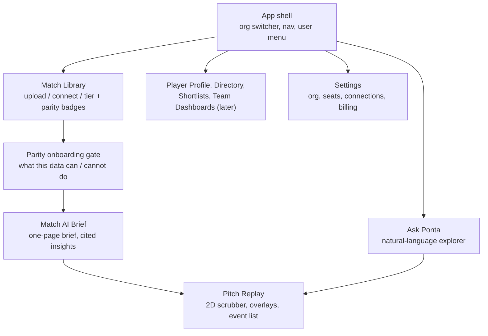
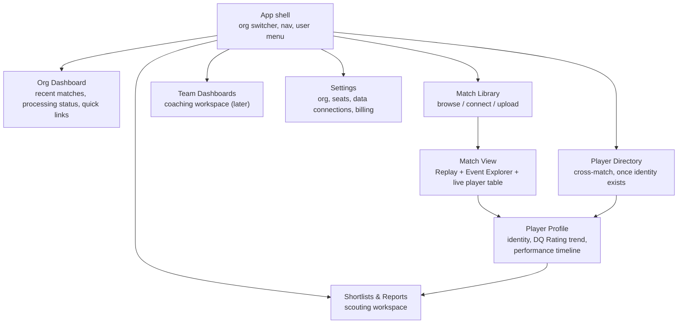

# Ponta Frontend

See [README.md](README.md) for the baseline assumptions this document builds on, [architecture.md](architecture.md) for the API this UI calls, [features.md](features.md) for what each screen needs to expose, and [visual-design.md](visual-design.md) for visual language. Shared with Ponta Website: the Ponta mark, accent `#1E76FA`, and hexagons where they carry meaning. The marketing site is now dark-hero / white-body; this portal can stay product-dark (`#1a1a2e`) when it is built. **Not to be confused with [Ponta Website](website.md)** — the public site at [pontahq.com](https://pontahq.com). This document is the authenticated client portal (`app.pontahq.com`) — **reserved, not live**; the website's Sign in control is disabled until it is. Named "Ponta Frontend," not "Plaiq Frontend," because it's the shared portal both products' tools will live in, even though everything specified below today is Plaiq's screens specifically (Matrix has no UI in scope yet — see "Future: surfacing Matrix provenance" below).

> **Revised for the AI-native one-product strategy.** The portal's core is now **three views plus an onboarding gate**: **Match AI Brief**, **Pitch Replay** (the former Match View), **Ask Ponta** (natural-language explorer), and the **Parity onboarding gate**. See [Revised information architecture and hero views](#revised-information-architecture-and-hero-views) below; the original IA and screens after it are retained, with Player Profile / Performance, Shortlists and Team Dashboards re-sequenced behind the core. Matrix is no longer "no UI in scope": Parity and confidence are first-class UI now (see the revised provenance note near the end). Desktop-first, English-only and the other v1 scope boundaries are unchanged.

## Revised information architecture and hero views

**Match AI Brief.** The landing screen for a processed match: a one-page brief for coaching and analysis staff (physiological content appears only at Tier 3 and is not medical advice) with confidence badges and a header stating the match's data tier and its Degraded/Blocked metrics. Every bullet is a **citation chip** (`event_id`, timestamp, confidence) that opens Pitch Replay at that moment. Nothing on this screen is uncited. It is also the shareable/printable artifact — design it as a page that exports well, which is the first step toward the report export gap noted in `features.md`.

**Pitch Replay.** Descends from the prototype's Analysis / Event Explorer mode: a pitch canvas with toggleable overlays (control zones, value heatmap, pass corridors, carry alternatives), a frame/event scrubber and a player table. Frames are read from `trajectories.parquet` through the API; on-demand overlays use the Redis-cached overlay endpoints. It can be opened from a brief citation, an Ask Ponta result, or the library.

**Ask Ponta.** A natural-language box that returns a short summary and a **playlist of replay chips**. *(Revised 16 November 2026: inside a match, Ask opens as a side panel beside Data check, Brief and Replay instead of navigating away; the standalone page remains for history and cross-match questions. See [frontend-design-brief-v2.md](frontend-design-brief-v2.md#ask-inside-a-match-new-16-november-2026).)* Before answering it states any parity limitation up front ("Wearable data isn't connected for this match — filtering by optical pressure only"). Named thresholds used are shown inline and are clickable for the definition. *(Corrected 17 November 2026: the earlier example, "pressure index ≥ 0.7", used a scale the engine does not have. Pressure is 1v1 pressure on a 1 to 10 scale, and no named threshold is defined yet. The shareable match page selects moments at 7 or more as a page rule; the UI prototype still shows a 0 to 1 index with 0.7, which must be aligned once the threshold is chosen. See [ai-layer.md](ai-layer.md#2-natural-language-tactical-and-physical-explorer).)* It must never display a free-form number the model computed; numbers always come from cited events.

**Parity onboarding gate.** After upload, a screen that explains in plain language what is **Full / Degraded / Blocked** for this data and why (frame rate, occlusion, event-only mode, missing GPS), what a second source would unlock, and the ingestion preview/data-quality check (`engine-governance.md`). This is both a trust feature and the natural prompt to bring a second source (Tier 1 → 2 → 3).

**Cross-cutting rules added by the pivot:**

- A persistent **tier and parity badge** per match, everywhere a match appears (library, brief, replay, Ask Ponta). Event-only decision-quality is a **visually distinct confidence class**, not the same number with a smaller badge.
- **Confidence has its own visual channel**, separate from the pressure/value heat colours (the earlier provenance design intent, now a requirement).
- **AI output is always visibly AI output**, with its cited events one click away and its limitations stated; never presented as a ground-truth rating.
- Player names are **rehydrated in the client** from the tenant's roster; the AI layer only ever saw pseudonyms ([ai-layer.md](ai-layer.md#pseudonymisation-and-llm-providers)).

## Information architecture *(original, retained)*

## The two hero screens

These map directly to the prototype's strongest existing UI and should be built first (see the frontend build order below).

**Match View (Replay / Event Explorer).** Descends from `app.py`'s Analysis mode (`make_plotly_frame`, `app.py:1372-1873`): a pitch canvas with toggleable overlays (control zones, value heatmap, pass corridors, carry-alternative heatmap), a frame/event scrubber, and a live player-analytics table beside it. The production version keeps this exact mental model — it already works and is the product's visual signature — but should read overlay data from API calls instead of local dataframes, and should get real player identity (names, photos if available) instead of jersey-slot labels.

**Player Profile / Performance.** Descends from the Player Performance mode (`app.py:3697` onward): identity card, on-pitch interval strip, physical profile, DQ Rating headline number with band colour, and the combined Decision-Quality + Off-ball Movement timeline charts. This is the screen to invest the most design polish in — it's the one most likely to be screenshotted into a scouting report or shared with a director of football, so it needs to look credible and "product," not "internal tool."

## Cross-cutting design principles

- **Consistent visual language for the analytics layer.** The same colour coding for control (home/away), value (heat), and pressure should mean the same thing on every screen — Match View, Player Profile, team dashboards, exported reports. Users will context-switch between screens constantly; inconsistent colour semantics would undermine trust in the numbers.
- **Progressive disclosure.** Lead with headline numbers (DQ Rating, an overall "Player IQ" score), let users drill into the per-event badge and its formula breakdown on demand. Never force the underlying math onto someone who just wants "is this player good."
- **Explainability is a first-class UI element, not a tooltip afterthought.** The existing DQ badge subtitle pattern (`"V(actual) ÷ V(best in ring) = 0.18 ÷ 0.42"`, confidence flag for inferred receivers) should be preserved and made prominent — it's the antidote to "black box AI rating" skepticism from a football-literate audience.
- **Design for the report, not just the screen.** Since scouting reports and media moment-cards are explicit features (see [features.md](features.md)), screens that feed those exports (Player Profile, single-event views) should be designed with an eventual "export this view" affordance in mind, even if export itself ships later.

## V1 scope boundaries

Three things a realistic v1 explicitly does not attempt, stated plainly rather than left as silent gaps:

- **Accessibility**: no dedicated accessibility program for v1, but get a meaningful baseline for free by building on an accessible-by-default component library (e.g. Radix primitives / shadcn-style components) rather than fully bespoke UI — cheap insurance against the alternative of retrofitting accessibility later.
- **Desktop-first, English-only.** Scouts and coaches plausibly want pitchside/tablet access eventually, and player names span non-Latin scripts, but v1 targets desktop browsers and English UI text only. The one cheap thing worth doing now: route UI strings through a simple i18n wrapper from day one (even with only one locale implemented), since retrofitting that after strings are scattered through components is far more expensive than starting with it.
- **Mobile-responsive layouts are out of v1 scope** — the pitch-canvas-heavy Match View in particular doesn't translate well to small screens without real design work, and that work is deferred until there's a validated reason (a customer segment that specifically needs it) to prioritise it over the features in `features.md`'s Now/Next/Later sequencing.

## Surfacing Matrix provenance *(revised: now in scope)*

**Revised:** the original note below deferred all Matrix UI because Matrix output was not yet the ingestion path for anything. In the one-product app **every match goes through Matrix** (at minimum Normalise), so the Parity Report, tier badge and frame-confidence overlay are part of v1, not a future item. What is still deferred is the *drill-down for fused provenance* (per-frame source attribution, `disagreement_m`), which only has meaning at Tier 2/3. The progressive-disclosure intent below still holds: no noisy ambient indicators on ordinary single-source matches beyond the tier/parity badge.

*(Original note, retained:)*

## Future: surfacing Matrix provenance (not v1 — no trigger exists yet)

Matrix's export schema (`matrix_engine/export.py`) already carries per-frame `confidence`, `source_attribution`, and `disagreement_m` — none of which surfaces anywhere in this document, deliberately. The design intent, so it isn't reinvented later: progressive disclosure, not a new pattern — no ambient indicator on directly-ingested single-vendor matches (the common case), a single summary badge only on matches that actually went through Matrix (naturally placed alongside `engine-governance.md`'s ingestion-preview step), an on-demand drill-down mirroring the DQ badge's existing explainability pattern, and — if built into Match View at all — a frame-level confidence overlay using its **own** visual channel, not a reuse of the existing pressure/value heat-colour (conflating the two would make an already-loaded colour channel ambiguous). Also worth revisiting at that point: whether a DQ Rating computed from confidence-flagged frames should say so, the same way the GK/set-piece "not yet scored" treatment already works.

**None of this is buildable yet, and deliberately isn't scheduled above** — `roadmap.md` doesn't currently say when, or whether, Matrix's output becomes the ingestion path for a real Plaiq customer at all (see the note added there). This design intent exists so the idea isn't lost, not because it's next.

## Suggested build order

**Revised:** (1) app shell + auth + org switching; (2) Match Library with tier/parity badges and upload; (3) Parity onboarding gate; (4) Match AI Brief; (5) Pitch Replay (from `trajectories.parquet`; HTML canvas, decided in [frontend-design-brief-v2.md](frontend-design-brief-v2.md#palette-and-type), so the Plotly spike is no longer needed); (6) Ask Ponta; (7) report/PDF export; then Player Profile, comparison, shortlists and team dashboards once cross-match identity exists. The original order below is retained as history.

1. App shell + auth + org switching (thin, but everything else nests inside it).
2. Match Library + Match View, wired to the real API from [architecture.md](architecture.md) — this alone reproduces the prototype's core value as a real multi-user product.
3. Player Profile / Performance screen.
4. Shortlists & basic report export (first persona-specific feature, per the Now/Next/Later sequencing in [features.md](features.md)).
5. Player Directory + comparison (once cross-match identity lands).
6. Team dashboards, media exports — later, per [features.md](features.md) sequencing.
