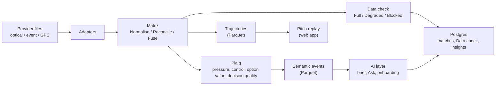

# Ponta Platform Overview

> **Snapshot, 17 November 2026.** A self-contained description of the platform for an independent reviewer (human or agent) with no other context. It summarises other documents and does not supersede them: for the current state see [status.md](status.md); for the plan see [roadmap.md](roadmap.md), [data-tiers.md](data-tiers.md) and [ai-layer.md](ai-layer.md). Update or retire it when those change materially. *(Revised later on 17 November 2026: context packages adopted and Ponta repositioned; see "Strategy update" below.)*

Ponta is a planned multi-tenant B2B SaaS for football clubs. A club brings its own match data from any supported provider; Ponta cleans it into one quality-scored dataset, computes explainable spatial metrics, states plainly what the data can and cannot support, and lets grounded AI explain the match with every claim cited to a moment you can replay.

Prepared 17 November 2026 for an independent review. Internal and candid: evidence status is stated on every capability. Sources: the planning repository (`ponta-blueprint`), the engine monorepo (`ponta-platform`) and the UI prototype (`ponta-platform-ui`).

## Summary

**One application, three parts.** **Matrix** is the data engine (Normalise, Reconcile, Fuse provider files into one canonical dataset). **Plaiq** is the spatial engine (pressure, control zones, pass option value, decision quality), run once at ingestion and compiled into **semantic football events**. A **grounded AI layer** reads only those events, never raw coordinates, cites every claim and reads a per-match **Data check** (internally the Parity Report: Full, Degraded or Blocked per metric) before it says anything.

**Where it stands.** Pre-product, solo founder, no customers. The two engines are extracted into a production monorepo with their tests and a semantic builder and Data check generator. The AI layer, API, worker, storage and production web app are designed but not built. A clickable UI prototype runs on mock data. A marketing website is deployed but not indexed or announced.

**Operating model.** Bring your own data. Post-match batch only, never live. Phases with evidence gates, not calendar dates.

### The one thing a reviewer should keep in mind

The single-source pipeline (Tier 1) rests on things proven on real data. The multi-source story the website leads with (reconciling two vendors, fusing GPS with optical tracking) is validated on **synthetic** data only. No real pair of sources for the same players or the same match exists in the project. The competitive teardown also found that SkillCorner already sells a very similar decision-quality concept at scale.

## Strategy update (17 November 2026)

The context the AI layer would read stops at single actions, which is not enough for a useful AI. Ponta is therefore repositioned from **an explainable decision-quality engine with a grounded AI brief** to **a match context model that the AI explains**. Deterministic **context packages** (P0 to P9) add possession and game state, team structure, relative zones, phase of play, relationships, movement types, space and value, and match episodes, each defined, versioned, covered by the Data check and labelled observed or estimated. Decision Quality becomes one field among many.

- **Committed now:** Stage A only (P0 foundations, P1 possession and game state), as engine work measured against event data on the Metrica matches. Stages B to D are planned but not scheduled; embeddings (P9) are Phase 5. *(Out of date: on 17 November 2026 the founder decided to proceed through Stages B to D against reference labels (decision 4a), and Stage B (structure, zones, phase of play) was built the same day. See [context-packages.md](context-packages.md) and [status.md](status.md).)*
- **The AI build waits** for Stage A at the earliest, preferably Stage B, so it is not built around thin answers.
- **Ponta computes its own context.** Provider-derived metrics a club already has are stored against Ponta's vocabulary for comparison only.
- **Unvalidated context fields** may reach analysts labelled "estimated, not yet validated", never player-facing views. Gates 2 and 3 need one or two analysts, which Ponta does not yet have.
- **Unchanged:** bring your own data, batch only, Tier 1 first, the Data check, gates E1 to E3 and the claim rules. Full plan: `context-packages.md`.

## Status at a glance

Status key:

- **[Real data]** validated on real provider data
- **[Synthetic only]** validated on derived or synthetic data
- **[Prototype]** built, mock data
- **[Designed]** specified, not built

| Capability | Status | Notes |
|---|---|---|
| Matrix Normalise across vendors | [Real data] | Metrica and SkillCorner open data normalised into one schema (Track A). Founder-run today, not self-serve. |
| STATSports GPS ingest | [Real data] | One real export ingested. Heart rate and accelerometer or gyroscope channels are ignored. |
| Plaiq spatial engine | [Real data] | Runs on Metrica and SkillCorner tracking; spec and tests exist. Construct validity (agreement with experts) is not established. |
| Event-only mode (StatsBomb) | [Real data] | Lower-confidence estimates shown as a range, a separate confidence class. |
| Matrix Reconcile (identity matching, clock sync) | [Synthetic only] | Tested on a degraded copy of one real recording. No real two-vendor pair. |
| Matrix Fuse | [Synthetic only] | 24.5% RMSE improvement over the better single input, on synthetic data only. |
| Data check generator (parity.py) | [Real data] | 12 metrics in 6 families, with reasons, measured figures and coverage; tested on the two golden matches. |
| Semantic event builder | [Real data] | Deterministic, pseudonymised, no coordinates; produced for both golden matches. |
| Shareable match page | [Real data] | Single offline HTML page built from real engine output (SkillCorner match 1886347). No generated prose. |
| Web app (library, data check, brief, replay, Ask) | [Prototype] | Vite and React, fake in-browser engine, synthetic tracking, sample brief text. Not connected to any backend. |
| AI briefs, explorer, onboarding assistant | [Designed] | No LLM is called anywhere yet. Provider and model not chosen. |
| API, worker, storage, auth, tenancy | [Designed] | apps/api, apps/worker, apps/web are empty placeholders. |
| Physiological data (heart rate, IMU), per-player baselines | [Designed] | New engineering; gated on legal review and real paired data. |
| Customers, pilots, pricing | [Designed] | None. Discovery calls are the first evidence gate. |

## How it works

Every uploaded file is compiled into one canonical, quality-scored store that both the replay and the AI read. The pipeline, in order:

- **Upload** provider files (optical tracking, event data or GPS).

- **Provider adapter** reads the native format.

- **Matrix** always normalises (schema, metres, units, playing direction, quality flags); it reconciles or fuses only when the data qualifies.

- **Data check** (`parity.py`) records, per metric, whether the data supports it and why.

- **Plaiq** computes pressure, control, option values and decision quality.

- **Semantic builder** writes one enriched row per pass, carry, off-ball run and defensive action.

- **Storage:** `trajectories.parquet` (for the replay only) and `semantic_events.parquet` (for the AI) in object storage, queried with DuckDB; match metadata, the Data check and generated insight cards in Postgres.

- **AI layer** writes a post-match brief and answers questions, reading only semantic events and the Data check.

## Data tiers

What a club gets depends on the data it brings. The app never waits on the hardest, least proven piece (fusing paired sources) to deliver the proven one (cleaning and analysing a single source).

|  | Tier 1: one source | Tier 2: two unpaired sources | Tier 3: paired sources |
|---|---|---|---|
| Club brings | One provider's export | Two sources not covering the same match (for example a vendor switch) | The same match from two or more sources (GPS with optical, optionally events) |
| Matrix does | Normalise | Reconcile: identity, timing, thresholds; calibration only where an overlap window exists | Fuse: per-frame combination with source attribution |
| App delivers | Data check, cited brief, Ask, replay, decision quality (optical); estimates (event-only); physical summaries only (GPS) | Workload continuity across a vendor switch, discontinuity flagged where no overlap exists | Decision quality shown against physical load in the same match, as association with confidence bands |
| Evidence | [Real data] | [Synthetic only] | [Synthetic only], plus unbuilt ingestion |
| Can ship before a design partner | Yes | Partly | No |

Within Tier 1 the three sub-cases differ sharply. **Optical tracking of both teams** runs the full engine. **Event data only** gives lower-confidence estimates shown as a range. **GPS only** covers one team, so opposition pressure and control are Blocked; it is a physical tier, not a tactical one.

Tier 3 needs five things that do not exist yet: a real paired match, ingestion of physiological channels, a statistical design that claims association only, a legal review of health data and of fusing vendors' data, and a second internal champion (sports science or medical) at the club.

## The engines

### Matrix (data engine)

- **Normalise:** one schema, coordinates in metres, consistent units and sample rates, playing-direction handling, quality flags, drift and dropout detection.

- **Reconcile:** cross-source identity matching, clock synchronisation, threshold harmonisation, calibration where an overlap exists.

- **Fuse:** weighted per-frame combination with confidence and source attribution. A state estimator is the documented next step if real data shows weighted averaging is not enough.

- **Providers:** Metrica (CSV and EPTS), SkillCorner, StatsBomb (events) and STATSports are the only providers treated as supported. Second Spectrum and Genius adapters exist but are fixture-tested only.

### Plaiq (spatial engine)

- **Pressure:** 1v1 pressure on the player on a 1 to 10 scale. No named "high pressure" threshold is defined by the engine yet; the shareable match page uses 7 or more as a selection rule, and the UI prototype still shows an older 0 to 1 index that must be aligned.

- **Control zones** (first-to-reach) and a **value surface** (threat by location).

- **Pass option value:** every option at release scored as value × chance of success (V × p).

- **Decision quality:** value where the ball arrived divided by the best option available at release. Range 0 to 1.5, not 0 to 1; above 1.0 the receiver arrived somewhere better than any option at release. Bands: Poor below 0.55, Suboptimal 0.55 to 0.79, Good 0.80 to 0.94, Optimal 0.95 and above.

- **Event value change** (ΔV), **off-ball movement value** and **failed-pass intent inference** (scoring the intended receiver of an intercepted pass, with a strong, medium or weak confidence category).

- Goalkeepers and passes from set pieces are **not scored**, with the reason stated.

## Data check and semantic events

### Data check (Parity Report)

Generated deterministically at ingestion, stored on the match, read by the UI and by every AI workflow before anything is generated. Twelve metrics in six families, each with a state (Full, Degraded, Blocked), a reason, a measured figure where one exists, and what would change it.

- GPS-only blocks opposition pressure and control and keeps physical summaries.

- Event-only degrades decision quality into a separate confidence class.

- Optical below 10 Hz, or with more than 10% of player observations missing, is Degraded with the figure shown.

- No physiological source blocks load and fatigue in every mode.

- **Coverage** sits beside the states: the share of passes and carries actually scored, and why the rest were not (ball not detected, goalkeeper, set piece, outside tracked frames). A metric can be Full while a large share of events is unscoreable.

- It doubles as the onboarding gate: after upload the club sees what it can and cannot do, and what a second source would unlock.

### Semantic event (one row per action)

The bridge between deterministic maths and language. Flat Parquet columns, also available as a nested record. Key fields:

| Group | Fields |
|---|---|
| Identity | event_id, match_id, timestamp_s, minute_display, period, schema_version, engine_version |
| Actor and action | actor_player_ref (a pseudonym such as home_6), action type and outcome, target, inferred intended receiver and its confidence category |
| Spatial intelligence | dq_score, dq_band, chosen_option_pov, best_option_player_ref, best_option_pov, xt_delta, movement_value, opposition_pressure (1 to 10), pitch_zone, mode (full tracking or event only), not_scored and reason |
| Quality gate | ball_detected, players_observed, per-section parity state |
| Physiological context | Null today; a target schema for Tier 2 and 3 only |

## Evidence and tests

### Prototype (frozen validation record)

964 passing tests, of which 582 are one parametrised ring-distance test; about 382 are behavioural. Tagged `prototype-validation-final`.

### Production monorepo

1,015 tests (1,003 in the full local suite, 12 opt-in equivalence). CI is green but skips data-dependent tests because licensed sample data never enters the repo.

### Equivalence

Plaiq fed through Matrix reproduces the prototype's golden outputs on both matches. On Metrica, 2 of 39,589 decision rows and 12 of 36,792 alternative rows differ by a characterised float near-tie. No band changes.

### Measured on real open data

Ball undetected in 32.2% of Metrica Game 3 frames and 26.4% of SkillCorner 1886347. SkillCorner coverage: 1,308 of 1,371 passes and carries scored (95.4%).

**Not established:** that decision quality agrees with expert judgement, its reliability per player across matches, and whether the brief's automatic moment selection matches what an analyst would flag. Two cautions are on record: the bands were tuned on the same match used for the public worked example, and the passer is the best option in about 65% of scored passes. A blind expert-agreement study (about 100 decisions, two or three analysts) is planned but not run. Until then the wording is "a defined, explainable score", never "accurate" or "predictive".

## AI layer (designed, not built)

**Principle:** deterministic engines compute facts; the language model only selects, summarises and explains semantic rows. Since 17 November 2026 the AI also reads **semantic states** (match episodes built by context package P8) and cites them as `[state_id, start_s, end_s]`; the AI build waits for context Stage A at the earliest.

### Hard rules

- No raw coordinates in any model context.

- Every claim cites `[event_id, timestamp_s, confidence_score]` plus `match_id`; an uncited statement is not shown.

- Data check first: Degraded and Blocked metrics are disclosed, never silently substituted.

- No free-form SQL: the model calls a small set of typed, validated tools.

- Pseudonymised prompts: names are added back only in the client from the club's own roster.

- No medical, injury or causal fatigue claims; association only.

### Workflows

- **Post-match brief:** deterministic selection of notable moments (no model involved in choosing), then a structured one-page brief with a citation per bullet, stored as an auditable insight card.

- **Ask Ponta:** natural-language questions mapped to a typed query tool with a closed filter schema; answers are a short summary plus a playlist of cited moments; unanswerable or Blocked questions get a stated refusal with alternatives.

- **Onboarding assistant:** explains the Data check in plain language.

- **Workload and transition monitor** (Tier 2, later): only after a real overlap window exists.

### Evaluation from the first commit

Runtime citation verifier (every cited id exists, every quoted number matches its row), a golden question set in CI, parity-honesty tests, adversarial prompts (injection, requests for names, coordinates or medical conclusions), and version pinning of prompts, model and tool schema on every stored insight. LLM spend is bounded by caps and rate limits; providers must be no-training and limited-retention, listed as sub-processors.

## Product surface (UI prototype, mock data)

A clickable Vite, React and TypeScript prototype with a fake in-browser engine, synthetic tracking for a few sample matches, and sample brief and answer text written by hand. It defines the experience; it computes nothing real.

### Match library

Table and card views, filters, saved views, Data check summary and status per match (processing, needs attention, failed with a stated cause).

### Add data

Upload or sample, file preview with mismatch detection, the Data check before processing, then processing stages. Provider connections shown as coming soon.

### Data check

Full, Degraded and Blocked counts, coverage with causes, metric families with reasons and figures, and what a second source would unlock.

### Match brief

AI-marked brief with cited moment chips, limits stated up front, a print or PDF view with repeated header and page numbers.

### Pitch replay

Canvas pitch with overlays (control zones, value, pass corridors, carry options, confidence), timeline, event list, player table, keyboard stepping, and an event card that explains each rating in one sentence with the working on request.

### Ask Ponta

A full page with conversation history and search, plus a side panel inside each match that stays open across Data check, Brief and Replay and can be asked about a brief point or a selected moment.

### Names and privacy

Everything below the client carries codes (`home_5`); names come from a club roster in the browser, with a Show names or Show codes switch. Questions are stored with codes.

### Shareable match page

A single offline HTML file built from real engine output: the Data check, coverage and rule-selected moments. Intended for a founder-run "concierge" pilot before the platform exists.

Also present: sign-in, settings (organisation, members and roles, data connections, privacy and deletion), a player profile sketch, global search, and a component reference sheet. Accessibility work includes contrast checks on 147 colour pairs, keyboard paths and screen-reader announcements; it has not had an external audit.

## Planned architecture (not built)

- **Monorepo** `ponta-platform`: two engine packages (built), plus API, worker and web apps (empty).

- **API:** FastAPI modular monolith; the AI layer is a module inside it, with server-sent events for streaming.

- **Worker:** queue-based ingestion (RQ unless a need for more appears).

- **Storage:** Supabase Postgres with row-level security for tenancy and metadata; Parquet in object storage (R2, S3 or Supabase Storage) read through DuckDB; Redis cache for on-demand pitch overlays.

- **Tenant isolation for files:** row-level security does not cover object storage, so the API is the only reader, builds every path itself under the organisation's prefix, and an automated cross-tenant test must pass in CI.

- **Hosting:** undecided (managed containers in EU regions recommended; static frontend possible).

- **Frontend framework:** Vite (the prototype) versus Next.js (the older docs), undecided, leaning Vite.

## Product rules carried into every spec

- Never call engine output "ground truth"; never claim validation that has not been produced.

- No real-time or live claims.

- No medical, injury or causal fatigue claims; "coincided with", never "caused by".

- No real player names in fixtures, mocks or generated artefacts.

- Only Metrica, SkillCorner, StatsBomb and STATSports are presented as supported; others are "coming soon".

- Engine maths is not changed during extraction; discrepancies are reported, not fixed.

- Licensed or unlicensed sample data is never copied into a repository.

## Market and competition

### Two wedges, chosen by discovery calls

| Wedge | Buyer | First value | Evidence |
|---|---|---|---|
| A. Single-export brief | Small analyst team with one provider, priced out of incumbents | Data check, cited brief, replay, explainable decision quality | Engine proven; value of the brief untested |
| B. Fragmentation and provider transition | Club with two systems or mid-switch, multi-team organisations, federations | Reconcile, workload continuity | Synthetic only; needs an overlap window |

The website's call to action and hero speak to wedge B and Tier 3, while Tier 1 (wedge A) ships first. This mismatch is a recorded risk.

### Competitive findings

- **SkillCorner Game Intelligence:** severe overlap. It already sells off-ball movement value, passing options, pressure degree and execution under pressure to 250+ teams, on its own tracking. Whether it scores failed actions by intent is unverified.

- **StatsBomb IQ (Hudl):** overlaps at the recruitment workflow level; its value metrics are a different construct.

- **Impect (being acquired by Catapult):** Packing credits only successful actions, a citable difference. Catapult now owns both wearables and a tactical value metric, the two ingredients of Ponta's Tier 3 idea; the most time-sensitive signal found.

- **Google DeepMind TacticAI:** research, not a product; confirms the top clubs are not a near-term market.

**Current differentiation thesis** (to be tested, not assumed; revised 17 November 2026): a match context model (possession, phase, shape, relationships, space, episodes) computed the same way for every supported provider, explained by grounded, cited, data-check-honest AI; explainable formulas shown with their working; credit for good decisions that did not complete (intercepted passes); and an affordable single-export entry point. Providers already sell some context metrics (for example phases of play and run categories), so whether analysts lack this context is itself a discovery-call question.

## Roadmap and gates

| Phase | Scope | Exit |
|---|---|---|
| 1. Foundation | Engine extraction (done), Data check and semantic builder (done); Supabase, FastAPI skeleton, storage, cross-tenant test, basic terms (to do) | Sample match yields a Data check and semantic Parquet; deployed API and auth skeleton; isolation test passing |
| 2. Tier 1 pipeline and AI | Concierge step first (run a prospect's export by hand, send the page back); upload connector, worker, AI workflows with guardrail tests from the first commit | Uploaded Tier 1 match yields a cited brief and a working Ask; all guardrail tests pass |
| 3. Web app and first users | Production web app from the prototype; two or three design partners; legal basics in place | One partner or customer using Tier 1 end to end with their own data |
| 4. Tier 2 and 3 on real data | Physiological ingestion, Reconcile and Fuse productisation, each gated on real data and legal review | Every Tier 2 and 3 claim backed by a recorded real-data result, or left "in development" |
| 5. Expand | Cross-match identity, comparisons, more providers, opposition analysis, pricing from real unit economics | Willingness to pay and real-data results |

**Evidence gates** (thresholds proposed, not confirmed): **E1**, at least 8 discovery calls with the wedge, intercepted-pass and price questions asked, unlocks the Phase 2 platform build. **E2**, one prospect has received a Data check and cited brief from a real export, unlocks Phase 3. **E3**, a design partner has used a brief and said what they would pay, unlocks any Tier 2 or 3 engineering and billing. A validation track (design partners, an overlap window, a paired match) and a legal track (terms, LLM sub-processor terms, health-data review, vendor licence check) run alongside throughout.

## Risks

| Risk | Severity | State |
|---|---|---|
| Differentiation: high overlap with SkillCorner | Critical | Confirmed finding; wedge decided by discovery calls |
| AI states something the data does not support | Critical | Controlled by typed tools, citations and a runtime verifier, once built |
| Overclaiming fatigue or medical insight | Critical | Claim policy: association only, Tier 3 gated |
| Parquet files leaking across tenants | Critical | API-only access, server-built paths, CI isolation test (not yet built) |
| Player data rights and sports-data law | Critical | Sequenced legal engagement |
| Decision quality lacks construct validation | High | Open: expert-agreement study planned |
| Vendor licence may forbid sending exports or derived data to a third party | High | Open: check before the first real export |
| Tier 2 and 3 depend on data that does not exist | High | Open: Tier 1 ships first; claims withdrawn if validation fails |
| Scope for a solo builder | High | Open: sequenced, no calendar dates |
| No customer evidence gating the build | High | Open: gates E1 to E3 proposed |
| Pitch and product ship in different orders | High | Open: two wedges named |

## Open decisions

- LLM provider and model (blocks Phase 2).

- Lead wedge, and the evidence-gate thresholds.

- Whether event-only analysis ships in the first release.

- Ask Ponta pricing: capped, metered or bundled.

- Hosting; Vite versus Next.js.

- Whether the website keeps listing Second Spectrum as supported.

- Public naming of Matrix and Plaiq inside one product; whether to publish the analytics specification or keep the formulas as trade secrets.

- A named, versioned "high pressure" threshold on the engine's 1 to 10 scale.
- What fills the confidence slot of a citation on a single-source match, which has no per-frame confidence (only ball detected and players observed).
- Context package thresholds (grid rate, inferred-possession share, possession agreement bar, and later ones per package), each measured before it is agreed.

## Questions for the reviewer

- **Wedge and differentiation.** Given SkillCorner's overlap, is wedge A (a cited, honest single-export brief) distinctive enough to sell? What evidence would change your view fastest?
- **Context model.** Is repositioning around a match context model the right answer to that overlap, given that providers sell some context metrics already? Is Stage A (possession and game state) the right first commitment, and is the validation plan (event data for Gate 1, analysts for Gates 2 and 3) realistic for a solo founder?

- **Sequencing.** Is the concierge step (founder-run page from a real export) the right first proof before building the platform? Are the gate thresholds sensible?

- **AI grounding.** Are the hard rules and evaluation plan sufficient to keep a cited brief trustworthy for coaches? What is missing from the citation verifier or golden question set?

- **Metric validity.** How should decision quality be validated before it carries weight in a brief, and how should uncertainty be shown per player?

- **Tier 2 and 3.** Is it realistic to obtain an overlap window and a paired match through design partners, and is the fused claim worth pursuing given Catapult and Impect?

- **Architecture.** Any concerns with Parquet plus DuckDB plus Postgres for a solo operator, or with the file-level tenant isolation design?

- **Legal.** Which legal gate is most likely to block a first pilot (vendor licence terms, LLM sub-processing, player data rights)?

- **Product surface.** Does the prototype's experience (Data check first, cited moments, replay, Ask in the match) match what an analyst team would actually use weekly?

## Where to look

| Repository | What it holds | Start with |
|---|---|---|
| ponta-blueprint | Planning: strategy, tiers, AI layer, architecture, roadmap, risks, legal, market, design briefs | status.md, README.md, data-tiers.md, ai-layer.md, roadmap.md, competitive-landscape.md, risks.md |
| ponta-platform | Production monorepo: Matrix and Plaiq engines, Data check, semantic builder, golden-output tools | EXTRACTION_REPORT.md, docs/ARCHITECTURE.md, tools/demo.py |
| ponta-platform-ui | Clickable UI prototype on mock data; shareable match page | docs/design-notes.md, docs/match-page-payload.md, docs/screenshots/ |
| ponta-prototype | Frozen validation record (Streamlit app, original engines, 964 tests) | ANALYTICS_SPECIFICATION.md, matrix_engine/README.md, CLEANUP_REPORT.md |
| ponta-website | Marketing site, deployed but not indexed | pontahq.com |
