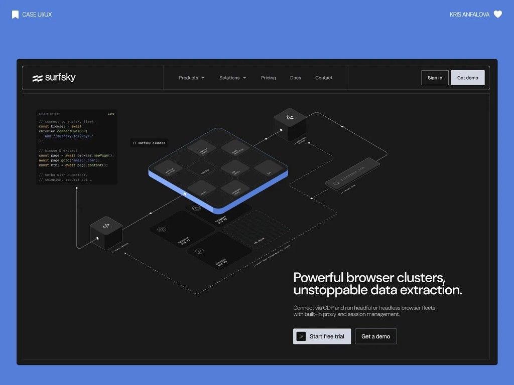

# Ponta Visual Design

See [website.md](website.md) for what **Ponta Website** says and what it deliberately doesn't; [frontend.md](frontend.md) for **Ponta Frontend**'s information architecture. This document covers the third thing neither of those does: what Ponta *looks* like, and why.

Scope note: this is written website-first. The visual language is still meant to be recognisably the same company as Ponta Frontend, but the **built site (`Ponta-Website` repo, not yet public) is the source of truth** for website look-and-feel. Ponta Frontend has not been built; do not reverse-engineer a dark-only, Inter-only product UI from the original reference tables below.

> **Revised for the AI-native one-product strategy (light touch).** The visual language of the website is unchanged. Two additions: (1) the product UI ([frontend.md](frontend.md)) stays product-dark and gains three visual requirements — a **distinct visual channel for confidence/parity** (not the pressure/value heat colours), a **tier and parity badge** system (Full / Degraded / Blocked, plus a visually separate treatment for event-only scores), and a **citation chip** component for AI output; (2) AI-generated content must be visibly marked as such. Whether the "Matrix"/"Plaiq" names and any hero imagery change at launch is open ([website.md](website.md#launch-positioning-one-product-ai-native)); until then the existing mark, accent `#1E76FA`, Geist and isometric-pitch language stand. No component-library design is done here (still deferred).

## How to use this document

**The shipped site wins.** [pontahq.com](https://pontahq.com) and the `Ponta-Website` repo are canonical. This document describes that language so the planning repo and the website repo stay aligned (`scripts/sync-context.py` pulls this file into the website repo). If a value here disagrees with the live CSS, the live CSS is right — update this file, don't "fix" the site back to an older spec.

The first version of this document was a close reproduction of a Surfsky reference (dark page, Inter, hero data panel, no hex wallpaper). The founder then approved a series of departures that are now the product: dark hero + white body, Geist, sticky nav, isometric pitch behind the illustration, frosted cards, honeycomb section backdrops, and a Plaiq worked example with traffic-light rating bands. Those are decisions, not experiments to revert.

The reference analysis and measured tables further down are **origin**, not instructions to rebuild toward. Use them only to understand why the first pass looked the way it did.

## The reference

A developer-tooling marketing site (Surfsky, case study by Kris Anfalova). Its stated design problem is worth quoting because it's almost exactly Ponta's: *"communicate complex backend architecture… without relying on intimidating walls of technical text."* Its answer is a premium dark theme, a custom isometric data-flow illustration mapping the routing process, and a realistic code-editor component to establish technical credibility — with an animation of data moving through the pipeline.

Matrix has the same communication problem and almost none of the same commercial model. So this document splits the reference explicitly into what transfers and what must not.

**Read the image carefully before borrowing from it — the blue field is not part of the design.** The surrounding blue is the designer's portfolio presentation backdrop, with the actual site inset as a rounded dark panel. Only the dark panel is the website. Reproducing the blue frame, or the inset panel treatment, would be copying a case-study mockup rather than a product design.

## What transfers

**1. The isometric data-flow illustration, as the primary explanatory device.** This is the strongest idea in the reference and the reason it's worth using at all. Matrix *is* a pipeline — multiple vendor sources in, three processing layers, one harmonised dataset out. An isometric diagram of that flow does in one glance what `Matrix.md`'s Problem and Solution sections need several hundred words to do. It also solves a specific problem the content draft couldn't: Matrix has no UI to screenshot, and `website.md` bans premature product screenshots — so the illustration becomes the hero visual *instead of* a product shot, which sidesteps that constraint honestly rather than working around it.

**2. A dark chrome, not an all-dark site.** The reference is all-dark. What shipped is a dark hero, nav and footer, and a **white body**. Continuity with the still-unbuilt product is the mark and the accent `#1E76FA`, not a matched page background. The prototype product remains `#1a1a2e`; Ponta Frontend can stay that way when it is built.

**3. A "real artefact" component to establish credibility.** The reference uses a live code editor. The transferable principle is *show the actual thing, not a description of it*. Which artefact is right for Ponta's buyer is settled below, in The credibility artefact — real sample data rather than code.

## Shipped visual language (canonical)

This is what pontahq.com actually is. Full copy and section order live in [website.md](website.md).

**Split surface.** Dark hero and nav (`#0A0A0A` / `#050505`); everything from "What Ponta is" through the contact form sits on **white** (`#FFFFFF`) with near-black text. The footer stays dark because the supplied logo is white. This is a founder decision, not a bug relative to the original all-dark spec.

**Nav.** Sticky at every width (including phones: ~56px logo row + ~40px link row). No vertical dividers. Links: What Ponta is, Matrix, Plaiq, FAQ. Outlined **Get in touch** button. **Sign in is visible but disabled** until `app.pontahq.com` exists (dimmed, lock icon, `aria-disabled`; the URL is kept in a comment in `index.html`). Active-section marker is a blue dot. Matrix stays marked through the whole Matrix run (problem → proof). Frosted near-black backing, darker (`rgba(10,10,10,0.96)`) so it reads over the white page.

**Hero.** `PontaFlow.svg` is the visual — enlarged to ~62% of container width, left-aligned. **No data-preview panel** in the hero (removed as clutter). One outlined Get in touch button, no Sign in in the hero. Behind the illustration: a faint isometric football-pitch outline with a honeycomb of flat-topped hexagons on the pitch surface (`css/experiments/pitch.css`). Cursor glow on the honeycomb is desktop-only and respects `prefers-reduced-motion`. Headline is **weight 600**, not 500.

**Below the hero.** Frosted-glass cards on white (near-black at 2–4.5% with a white top highlight, 18px backdrop blur). Section backdrops use a hairline honeycomb, faded at the edges — not inside cards, not behind the hero, not behind the nav. No blue-filled buttons; the brand blue `#1E76FA` is for the logo, illustration pulses, focus rings, and the Plaiq "best option" marks.

**Type.** **Geist** (variable) for UI text, **Geist Mono** for labels and data. Both SIL OFL, self-hosted Latin-subset `woff2` in the website repo. Inter and JetBrains Mono remain as fallbacks. No Google Fonts CDN.

**Hexagons.** The original restraint rule ("only where load-bearing") is relaxed in three shipped places, and only those: (1) the hero pitch honeycomb, (2) faint honeycomb section backdrops, (3) Plaiq diagrams, where the metrics are actually computed on a hexagonal grid. Still no hex-shaped buttons or hex-framed avatars.

**Credibility artefacts sit in the body, not the hero.** Matrix proof is the `#proof` section (Metrica vs SkillCorner formats, then two separate after-normalisation tables — never one mixed table, because the fixtures differ). Plaiq proof is the `#plaiq-data` worked example: real scored decisions on Metrica Sample Game 3, drawn in code. Rating bands in that section use traffic-light colours (Poor red, Suboptimal amber, Good lime, Optimal green) — a departure from the monochrome-only rule, limited to this section.

**Colour tokens (hero / dark chrome):**

| Role | Hex | Where |
|---|---|---|
| Hero / nav / footer background | **`#0A0A0A`** | Dark chrome |
| Recessed (dark) | `#050505` | Dark form fields, dark cards |
| Body background | **`#FFFFFF`** | Everything under the hero except the footer |
| Accent | **`#1E76FA`** | Logo, illustration, focus, best-option marks. **Not** a button fill. |
| Body headings | `#0A0A0A` | White page |
| Body text | `#1F1F23` | White page |
| Inline links (white page) | `#1558C9` | AA on the card tint |
| Inline links (dark) | `#4A90FB` | AA on `#0A0A0A` |

The product's colour semantics still hold for Ponta Frontend (`#E63946` home, `#1D8CF8` away, `#FFD700` event, pitch green, heat gradients). *(Superseded for the product, 17 November 2026: the values are now fixed in [frontend-design-brief-v2.md](frontend-design-brief-v2.md#palette-and-type). Home is crimson `#d6293d`, away is teal `#2bc7b9` (resolving the away-blue versus brand-blue collision), the event highlight stays `#ffd700`, and the pitch is `#16231b`. Error and warning colours were moved off the decision-quality band hues. The meanings, and the rule below, are unchanged.)* They stay out of website chrome except the Plaiq rating-band colours above.

## The structure transfers too, relabelled

The reference's *claim* structure still does not transfer: no free-trial button, no pricing, no invented logo wall, no product screenshots. Copy the furniture that shipped; don't copy the promises.

The original two-divider, four-item nav is **not** what shipped — see **Shipped visual language** above. Pricing remains omitted. "Request a demo" and "Start free trial" remain rejected.

## Ponta's own design architecture

**The substitution that makes the reference *Ponta's* is the illustration's subject, not a motif.** The reference centres a generic server cluster; Ponta's illustration shows Matrix's real pipeline (inputs, the Matrix engine with its Normalise / Reconcile / Fuse layers, the unified dataset, and Plaiq). That is supplied as a finished asset (see below), so the page itself draws nothing isometric and needs no projection maths.

**Hexagons.** See **Shipped visual language** above for the three places they now appear. Still no hex-shaped buttons or hex-framed avatars.

**The palette** is documented in **Shipped visual language**. The original all-dark `#1A1A1A` page is **not** what shipped. Accent remains the logo blue `#1E76FA`. Continuity with Ponta Frontend (when it exists) is the shared accent and the Ponta mark, not a matched page background — the marketing site is now dark-hero / white-body, and the product UI is a cool near-black (`#0e1116`, see [frontend-design-brief-v2.md](frontend-design-brief-v2.md#palette-and-type); the old Streamlit prototype used `#1a1a2e`).

**The product's colour semantics still hold, and still constrain the site.** `app.py` assigns meaning: `#E63946` = home team, `#1D8CF8` = away team, `#FFD700` = event, `#2d6a2d` = pitch, plus heat gradients for value and pressure. *(Those are the Streamlit prototype's values; the product's current ones are listed above. Reserve the current home crimson and team teal in the same way.)* `frontend.md` requires those meanings stay consistent everywhere. So the rule survives the palette change unaltered — **reserve, don't spend:** `#E63946` (reads as both "home team" and, conventionally, "error"), the heat gradients, and pitch green stay out of site chrome. Keeping them out is what lets them keep meaning inside the product.

## The Ponta hero illustration

**The illustration and its animation are supplied by the founder, hand-built, and committed into the website repo. Do not generate, redraw or approximate one.** An earlier generated SVG (and the script that produced it) was deleted on purpose: it wasn't good enough. The supplied asset is authoritative for how the illustration looks and moves; place it and scale it, don't reinterpret it. The whole site is built in code in the website repo; there is no design-tool step. The isometric pitch behind the SVG is a separate CSS drawing; it does not alter the SVG.

The list below is the **story the illustration tells**, not a spec for its drawing. Where the supplied asset differs in detail (cell counts, exact geometry, label placement), the asset wins. The composition reads left to right as Matrix's actual pipeline, substituting real subject matter for the reference's generic server cluster:

1. **Inputs** — three small cubes, each with a plain glyph (circle, triangle, square), labelled by *category*, not vendor: optical tracking, GPS / wearables, event feed. Category labels are deliberate: `Matrix.md`'s Supported Inputs table shows most named vendors' adapters aren't built, and the content draft decided to name vendors only where a real proof point requires it. Vendor logos here would imply support that doesn't exist.
2. **The Matrix engine** — the centrepiece: a stack of rounded isometric slabs carrying the Ponta mark. In the animation the stack opens up to reveal its layers, **Normalise, Reconcile, Fuse**. This doubles as the commercial staging from `Matrix.md`'s product tiers, so one diagram carries the technical story and the sales story.
3. **Output** — a wide slab, the **unified dataset**.
4. **Plaiq** — a cube with a hexagon glyph at the far end, fed by the unified dataset (Plaiq's own layers in the asset are named Plaiq Engine / AI Insights). Plaiq consumes Matrix's output; it is not a Matrix layer, and the diagram should never read as if it were.

Dashed grey pipelines connect all of it along the isometric axes, with small blue dots travelling along them.

The hero has no HTML data panel. Proof tables live in `#proof`, as HTML, independent of the SVG.

## The credibility artefact: not in the hero

The hero data-preview panel specified in the first version of this document **did not ship**. Founder instruction: too cluttered. The hero is the illustration, the headline, the sub-line, and one button.

Proof lives in the body instead, in two places:

1. **`#proof` — Matrix Normalise on open data.** Two vendor cards (Metrica, SkillCorner) with native format facts, then an "After normalisation: one schema, both sources" block with **two separate small tables**. The rows come from different fixtures; a single mixed table would imply a shared timeline and is forbidden. Credit: "Data: open sample data published by Metrica Sports and SkillCorner."
2. **`#plaiq-data` — one decision, scored.** Real Plaiq output on Metrica Sample Game 3, drawn in code (not a screenshot). Player anonymised. Credit required.

Both name vendors, so the SkillCorner/Metrica licence check in [website.md](website.md) applies to v1. Show **normalised** tracking columns, never fused-only columns (`source_attribution`, `disagreement_m`, etc.).

A historical note, because an earlier table in this document labelled SkillCorner's facts (JSONL, 10 Hz, metres, per-period clock) as "GPS / tracking source". SkillCorner is optical broadcast tracking. GPS on this site, when named, is STATSports. Do not repeat that mislabel.

## The animation

The reference's flowing-pipeline animation is the right instinct, and it's *more* apt for Ponta than for the original: it can show the actual value proposition rather than just decorating it. **Two streams arrive misaligned — different timestamps, different sample rates, drifting apart — and converge into one aligned stream.** That is reconciliation, shown rather than asserted. It's also the one thing genuinely hard to convey in prose, which is the test for whether an animation earns its cost.

**It should show fusion working, and that's legitimate.** The animation depicts the intended end state — streams arriving misaligned and converging cleanly — because that *is* the goal and intention of the product, and that's what the hero is for. This is the same register the headline already operates in: "The operating system for football tracking data" is an ambition, not a delivered-capability claim, and it was approved on exactly that basis. A concept diagram gets the same latitude.

The real constraint is narrower than "don't show fusion." It's about *register*: the hero must stay visibly a **diagram**, not a mock-up of working software. An abstract isometric illustration reads as "this is what Matrix does" — vision, universally understood as conceptual, the same way nobody mistakes an architecture diagram for a screenshot. A realistic-looking dashboard showing plausible fused numbers reads as "this is Matrix having done it" — evidence. Only the second needs the tier caveats attached, and the site shouldn't contain one.

Which means the overclaim risk lives somewhere other than where it first appears: **not in the animated diagram, but in the realistic credibility artefact** — the data preview panel. A clean data table of harmonised output is exactly the thing a visitor would read as a real result. Keeping the registers separated is what makes both honest — the hero carries the ambition, and the sample-data proof point (content draft §6, with its explicit "what this shows / doesn't show" split) carries the evidence, bounded and factual. Two different jobs, and they shouldn't blur into each other.

Two further constraints, each non-negotiable for a different reason:

- **It must stay static-site-cheap.** `website.md` commits to a static site on a Cloudflare Worker (assets from `dist/`). That means SVG + CSS animation, or at most a small Lottie file — not WebGL/Three.js, not a heavy JS scene. The hero shouldn't cost more to load than the rest of the site combined.
- **It must degrade to a still.** Honour `prefers-reduced-motion`, and make sure the frozen illustration reads correctly on its own — the diagram has to explain Matrix without motion, because for some visitors it will never move.

**What the supplied animation does** (`PontaFlow.svg`, 982 × 637, one 10.15 s linear loop, pure CSS keyframes, no JavaScript): blue dots travel the dashed pipelines from the three input cubes into the Matrix engine in two waves (roughly 0–4 s and 5–9 s); from about 2 s the engine's stack lifts apart into its layers and holds open until about 8 s while dots pass through and out toward the unified dataset and Plaiq; the stack closes at about 10 s and the loop restarts. It illustrates the pipeline's flow and layering. It does **not** depict misaligned streams converging; an earlier version of this section asked for that, and the supplied animation is the decision.

**The animation is supplied by the founder along with the illustration.** The agent building the page does not design or write the motion. Its job is to embed the asset, preserve its behaviour, and make sure the two constraints above hold: it stays cheap to load, and it degrades to a legible still under `prefers-reduced-motion`. If the supplied asset doesn't already handle reduced motion, wrap or pause it from the page and flag that rather than editing the asset.

## Tone target

Public tone is owned by [website.md](website.md): promote what Ponta does and is building; do not write limitation copy on the page. Visually that still reads as serious infrastructure, not a pitch deck — Geist, tight headline leading, no glow, no blue-filled buttons. Hierarchy in the hero: the headline is typographically dominant, the illustration is second, the Get in touch button is third. There is no secondary hero button.

## Measured reference values

Every number below was sampled or measured off `assets/reference-surfsky-isometric-dataflow.png` rather than estimated by eye. The reference image shows the site inset at 959px wide; proportions are given as a percentage of container width, because those are scale-independent, with concrete values at a 1440px viewport alongside.

| What | Measured | % of container | At 1440px |
|---|---|---|---|
| Nav bar height | 61px | 6.36% | **92px** |
| Nav divider 1 (after logo) | x = 325 | 30.6% | 440px |
| Nav divider 2 (before buttons) | x = 693 | 68.9% | 992px |
| Content side inset | 40px | 4.2% | **60px** |
| Data panel (square) | 161 × 161px | 16.8% | **242 × 242px** |
| Primary button | 115 × 30px | — | **173 × 45px** |
| Button gap | 8px | — | 12px |
| Headline block left edge | x = 586 | **57.8%** | 832px |
| Headline top | y = 541 | 69.4% of hero height | — |

Absolute type sizes can't be recovered from a scaled mockup — only ratios can. The reference's ratios are headline : sub-headline : nav = **2.5 : 1 : 0.75**, from measured cap heights of 20px, 8px and 6px. The scale below anchors that at a 17px body size.

Three measured findings are worth calling out because they are the ones most likely to be "improved" by accident:

- **The headline is medium weight, not bold.** This is most of why the reference reads as credible infrastructure rather than as a pitch deck.
- **The headline's leading is extremely tight** — measured line pitch of 24px against a 20px cap height, i.e. roughly 0.88. Two-line headlines nearly touch, deliberately.
- **The reference's greys are lighter than dark-theme convention.** Sub-headline measures `#C3C3C3` (9.9:1) and nav links `#A7A7A7` (7.2:1). Both clear AAA. It does not use the dim low-contrast grey that usually signals "premium dark theme", and is better for it.

## Typography

**Geist (variable) for UI text, Geist Mono for labels and data — this is what shipped.** Both SIL OFL, both self-hosted as Latin-subset `woff2` in the website repo. No Google Fonts CDN. Inter and JetBrains Mono stay in the font stack as fallbacks. Tabular figures still apply (`font-variant-numeric: tabular-nums` on numeric columns). The original Inter / JetBrains Mono pairing below is the reference-era spec, not the live site.

Implementation notes: variable font means one file covers every weight, `font-display: swap`, and `<link rel="preload">` the Inter subset since the headline is above the fold. Latin subset only.

**Scale.** Six steps, no more. Fluid between mobile and desktop via `clamp()`:

| Role | Desktop | Mobile | Weight | Line height | Tracking |
|---|---|---|---|---|---|
| Display (headline) | **44px** | 32px | **500** | **0.95** | −0.02em |
| Section heading | 30px | 25px | 500 | 1.20 | −0.01em |
| Sub-heading | 20px | 18px | 500 | 1.30 | 0 |
| Body / sub-headline | 17px | 16px | 400 | 1.55 | 0 |
| Small / caption | 14px | 14px | 400 | 1.50 | 0 |
| Mono (data, labels) | 13px | 12px | 400 | 1.50 | 0.02em |

Display size is fluid: `clamp(2rem, 3.05vw, 2.75rem)`. The 3.05vw midpoint is the measured 2.87% of container width plus the side insets.

Two values in that table are the ones to not second-guess:

- **Weight 600 on the live hero headline** (founder request). The reference measured 500; do not "correct" it back.
- **Line-height 0.95.** The reference measures ~0.88, which is tighter still; 0.95 keeps descenders and any diacritics safe while preserving the effect. Do not round it up to a comfortable 1.2 — the tightness is the point, and it's load-bearing for a two-line headline.

**Text colour, with contrast verified against the `#1A1A1A` background:**

| Role | Hex | Contrast | Use |
|---|---|---|---|
| Headline | `#FFFFFF` | 17.4:1 | Headline and the logo wordmark only. Pure white, as measured. |
| Body | `#EDEDED` | 14.9:1 | Body prose. |
| Secondary | `#C3C3C3` | 9.9:1 | Sub-headline, supporting prose. Measured from the reference. |
| Tertiary | `#A7A7A7` | 7.2:1 | Nav links. Measured from the reference. |
| Quaternary | `#8A8A8A` | 5.0:1 | Captions, table headers, illustration labels. **Do not go dimmer than this for any text.** |
| Accent (graphics) | `#1E76FA` | 4.17:1 | Logo, icon, illustration, focus rings. Fine for graphics and large text (24px+). |
| Accent (link text) | `#4A90FB` | 5.53:1 | Inline links at body size. |

That last pair matters and is a genuine trap. **The brand blue is not AA-compliant as body-size text** — `#1E76FA` measures 4.17:1 against `#1A1A1A`, under the 4.5:1 threshold. Fine for graphics; using it for inline links would quietly fail accessibility, so links get the lightened `#4A90FB` instead. For the same reason, white text on a `#1E76FA` fill is only 4.18:1: another reason not to use it as a button background.

## Layout and grid

- **Container max-width 1440px**, side inset 4.2% (min 24px, max 60px). Wider than the 1200px an earlier version of this document specified, because the hero is effectively full-bleed in the reference and the illustration needs the width.
- **Prose measure capped at 68ch** (roughly 640–680px). The container is wide for the illustration and the data table; running body text to 1440px would be unreadable.
- **Spacing scale, 4px base with an 8px working rhythm:** 4, 8, 12, 16, 24, 32, 48, 64, 96, 128. Nothing off-scale.
- **Section vertical rhythm:** 128px desktop, 64px mobile. This is where "generous" actually lives — the reference's breathing room is mostly large vertical gaps, not large margins.
- **Hero height:** `100vh` with a `min-height` of 720px, matching the reference's single-screenful hero.

**The hero composition is still diagonal, without the data panel.** Illustration left (~62% of container width), headline and one Get in touch button lower-right. The isometric pitch sits behind the illustration. On mobile it stacks illustration → copy → button, but **the `<h1>` must still come first in DOM order**.

## Geometry

**The supplied `PontaFlow.svg` is true isometric (30°).** Do not re-project, rotate or skew it. The page **does** draw one extra isometric object: the faint pitch outline + honeycomb behind the hero (`css/experiments/pitch.css`), at the same 30° as the SVG. That is a founder-approved exception. Do not add further isometric drawings.

**Corner radii:** 4px inputs, 8px buttons and cards, 12px large panels. Soft, not hard-technical — matching the reference, where the rounded isometric tiles are a lot of why it reads premium rather than clinical.

**Borders:** 1px at `rgba(255, 255, 255, 0.08)`. Very low contrast, doing separation work without drawing attention. The reference's floating cards are barely outlined and that's the point.

**Nothing glows, with one shipped exception:** the hero-pitch honeycomb brightens in a soft radial under the cursor on desktop (`css/experiments/pitch.css`). No glowing buttons, no glowing borders, no glowing text, and no drop-shadow haloes around the illustration.

## Brand assets

Supplied by the founder; they live in `assets/` in the website repo. Use them as-is. Do not redraw, recolour, trace, stretch or re-type them. The nav, hero and footer are dark, so those use the white logo. The body is white; do not recolour the supplied white logo to sit on it.

| File | What it is | Use |
|---|---|---|
| `assets/ponta-logo-white.png` | Mark + "Ponta" wordmark, white, transparent, 1745 × 310 | The nav logo. Render at **28px tall** (≈158px wide; the source is large enough for 2× screens). That height is a judgement call, not a measurement; the reference's logo is a different shape. Give it `alt="Ponta"`. |
| `assets/ponta-icon-blue.png` | Mark only, brand blue `#1E76FA`, transparent, 600 × 303 | Small standalone mark. A square favicon derivative (`ponta-icon-blue-square.png`) is what browsers use. |
| `assets/PontaFlow.svg` | The animated hero illustration, 982 × 637, transparent background | The hero. See the illustration section. |

The blueprint also holds black logo and icon variants and a white icon. They are for light backgrounds and are deliberately not copied into the website repo.

**`PontaFlow.svg` handling.** It is pure SVG with embedded CSS keyframes (21 of them, one 10.15 s loop) and carries the Ponta mark inside it as an embedded PNG, so it has no external requests. All of its labels are outlined paths, not `<text>`, so it exposes nothing to screen readers or search on its own. Reference it with `` and write a real `alt` that describes the pipeline in a sentence (inputs, Matrix engine, unified dataset, Plaiq) rather than leaving it empty. It ships with **no `prefers-reduced-motion` handling**. The one permitted edit to the file is appending `@media (prefers-reduced-motion: reduce) { * { animation: none !important; } }` at the end of its `<style>` block, so the frozen first frame is shown; change nothing else in it. If the first frame doesn't read as a legible still, flag that rather than fixing it.

## Open questions

None outstanding for the website. Favicon (`ponta-icon-blue-square.png`) and logo both exist in the website repo.
*Resolved:* the illustration is hand-built and in the website repo; a generated SVG was discarded. The hero has **no** data panel. Proof and the Plaiq worked example ship in the body and do name vendors, so the open-data attribution question is in v1 (see [website.md](website.md)). Favicon: a square derivative of the blue icon ships in the website repo (`ponta-icon-blue-square.png`). The logo exists.

## What this document deliberately does not do

- **No component library.** Buttons, nav and the data panel are specified by their measured dimensions and colours, not as a token system. The site is one page; a design system would be scaffolding for a building that doesn't exist.
- **No separate visual identity for Ponta Website vs. Ponta Frontend.** The two stay deliberately separate *systems* (`website.md` is emphatic about that) but should share one visual language. This document is the shared part.
- **No copy.** `content/draft.md` in the website repo owns the words; [website.md](website.md) is the planning-repo summary of what shipped. Where this document quotes a headline, it's quoting that.
